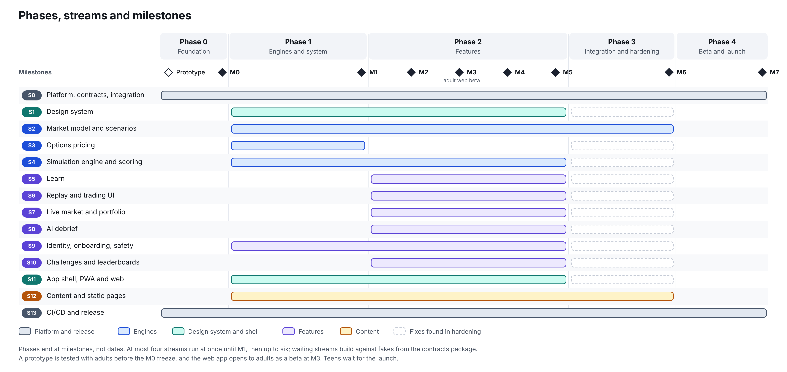
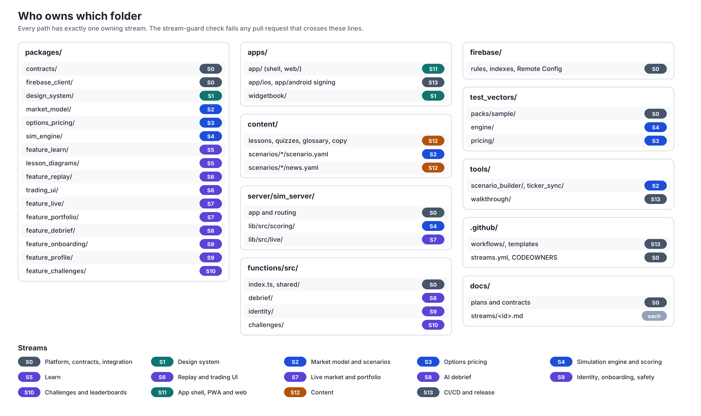
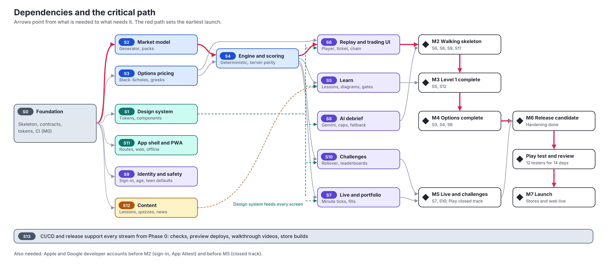
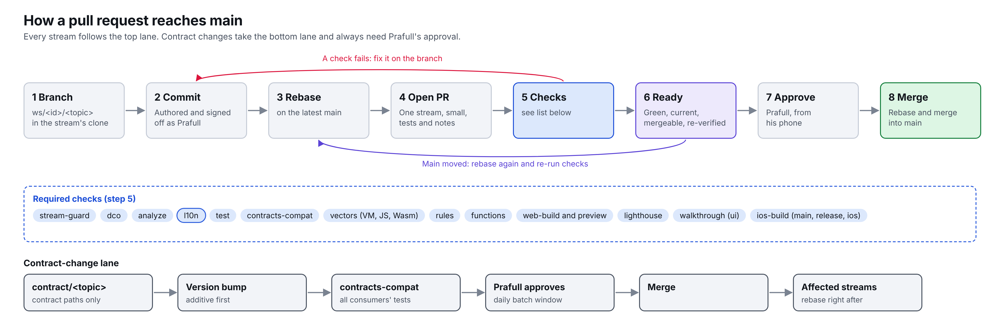

# Trading Simulator: Implementation Plan v1

Nov 27, 2026 · Prafull Kotecha

This plan turns the [Product spec](spec.md), the [UX and UI design guide](design-guide.md) and the [Lesson plan](lesson-plan.md) into a build that many coding agents can run at the same time without touching each other's code. Anything the spec did not already decide is marked **Proposed** and collected at the end for sign-off.

## Summary

The build runs in five phases. One stream builds the foundation alone; then up to six streams at a time build in parallel, each owning its own folders and talking to the others only through frozen contracts.

- **Phase 0, Foundation:** one stream builds the repository skeleton, every shared contract, the design tokens and CI, so every later stream starts from code that already compiles.
- **Phase 1, Engines and system:** the market model, options pricing, simulation engine, design system, app shell, sign-in and content start in parallel.
- **Phase 2, Features:** Learn, Replays, Live and Portfolio, AI debrief and Challenges are built on top, and the first end-to-end slice runs on iOS, Android and the web.
- **Phase 3, Integration and hardening:** accessibility, performance, security, privacy, cost guards and content sign-off.
- **Phase 4, Beta and launch:** TestFlight, the Google Play closed test, store review and the production web app.

Three rules keep the streams off each other's toes:

1. **Exclusive paths.** Every file in the repository belongs to exactly one stream, listed in `.github/streams.yml`. A CI check fails any pull request that touches a path its stream does not own.
2. **Frozen contracts.** Shared types, interfaces, the Firestore schema, API shapes, routes and design tokens are written and frozen in Phase 0. They change only through a contract-change pull request that Prafull approves.
3. **One stream per pull request.** A branch is named for its stream, every pull request is rebased on main, and it is "ready" only when every check is green and it has been re-verified.

**What Prafull does:** sign-ins and approvals only, listed with their costs in the next section. Nothing in this plan needs him to run a command.

## What needs Prafull, and what it costs

Every recurring cost is listed here before it is incurred, as the build rules require. Development costs **$0 a month** on GitHub, because the repo is public and GitHub protects branches on public repos for free. Launch adds the spec's **~$81 a month** at 1,000 active learners.

| # | Step | When | What Prafull does | Cost |
| --- | --- | --- | --- | --- |
| 1 | Approve this plan and its Proposed items | Before Phase 0 | Reads the plan and says go, or changes items | $0 |
| 2 | Protect main | Before Phase 0 ends | Adds a free branch ruleset on main on github.com: pull requests only, required checks, branch current with main, no force pushes | $0. The repo is public, and GitHub Free protects branches on public repos ([GitHub Docs](https://docs.github.com/en/repositories/configuring-branches-and-merges-in-your-repository/managing-protected-branches/about-protected-branches)). |
| 3 | Firebase projects, dev and prod | Phase 0 | Approves one Google sign-in in the browser; Claude creates both projects and keyless deploy access from GitHub; Prafull enters a card for the Blaze plan himself | $0 in development, inside the free tiers. Budget alerts at $5 (dev) and $100 (prod) (**Proposed**). |
| 4 | Gemini API key for production debriefs | Phase 2 | Nothing beyond step 3; the key is created in the prod project and kept in Secret Manager | ~$72 a month at 1,000 learners (already accepted). Development uses template debriefs; each run of the debrief quality test costs about $0.20 and runs only when debrief code changes. |
| 5 | Apple Developer Program | Start of Phase 1 | Enrolls with his Apple ID and approves 2FA on his phone; decides individual or organization first (an organization needs a free D-U-N-S number, which can take days) | $99 a year. Needed for Sign in with Apple, App Attest and TestFlight. |
| 6 | Google Play Console | Start of Phase 1 | Registers and completes identity verification | $25 once. A personal account created after Nov 13, 2023 must run a closed test with at least 12 testers for 14 days in a row before it can publish ([Play Console Help](https://support.google.com/googleplay/android-developer/answer/14151465)); an organization account is not named in that rule. |
| 7 | Store automation keys | Phase 2 | Approves creation of an App Store Connect API key and a Play service account in the browser | $0 |
| 8 | iOS build runner | Phase 1 | Signs in to Codemagic with GitHub (**Proposed**), or approves Tenki macOS runners if Tenki offers them | $0 within Codemagic's 500 free macOS minutes a month for personal accounts ([Codemagic pricing](https://docs.codemagic.io/billing/pricing/)). Linux jobs run on his Tenki runners at Tenki's per-minute rate, checked at setup. |
| 9 | 12 or more closed testers | Phase 3 (M5) | Invites friends or family to the Play closed test and asks them to stay opted in for 14 days | $0 |
| 10 | Counsel review | Before Phase 4 | Engages counsel for the spec's open legal questions (real names, age rating, not advice) | Counsel's fee; outside this plan |
| 11 | Pull request approvals | Throughout | Approves merges from his phone; contract-change pull requests always need his approval | $0 |

Nothing else needs him. Claude makes no purchase, accepts no terms and creates no account without his yes at the step.

## Phases and milestones



Phases end at milestones, not dates; the build cannot see how long agents, reviews or store queues will take, so the plan orders the work and names what each step waits on.

| Phase | Streams running | Milestone at its end | Exit test |
| --- | --- | --- | --- |
| 0 Foundation | S0 alone | **M0 Skeleton frozen** | Main is green; every package, route, Firestore collection, API and token exists as a compiling stub or fake; contracts v1.0.0 tagged; CI enforces stream paths; one UI pull request has proven the walkthrough video plays on the pull request page |
| 1 Engines and system | S1, S2, S3, S4, S9, S11, S12, S13 (S0 integrates) | **M1 Engine in the loop** | The March 2020 pack is generated, calibrated and frozen; a command-line replay scores identically on the Dart VM, JavaScript and WebAssembly; Black-Scholes matches reference vectors; the component catalog is live on a preview URL; sign-in works on all three platforms |
| 2 Features | S5, S6, S7, S8, S10 join; S1, S9, S11, S12 continue | **M2 Walking skeleton**, then **M3 Level 1 complete**, **M4 Options complete**, **M5 Live and challenges** | See Integration milestones |
| 3 Integration and hardening | All streams fix; S0 leads | **M6 Release candidate** | Every Definition of done below is met; audits pass; content signed off |
| 4 Beta and launch | S13 leads; S0 and owners fix | **M7 Launch** | Apps approved in both stores; web app live; URL in the repo's Website field and README |

At most six streams run at the same time (**Proposed**), so Prafull's review queue stays small enough for a phone. Streams that wait (for example S7 until the engine exists) start on fakes from the contracts package and swap in the real implementation at a milestone.

## Repository layout and ownership

The repository becomes a Dart pub workspace monorepo (**Proposed**). Every path has one owning stream; the table under Workstreams lists them.



```text
apps/
  app/                    Flutter app for iOS, Android and the web (S11)
    lib/shell/            router composition, adaptive scaffold (S11)
    web/                  index.html splash, manifest, icons, service workers (S11)
  widgetbook/             component catalog (S1)
packages/
  contracts/              shared types, interfaces, fakes, routes, events, keys (S0, contract PRs only)
  firebase_client/        Firebase init, auth, App Check, Remote Config, analytics wrappers (S0)
  design_system/          tokens, theme, themed and custom components (S1)
  market_model/           synthetic market generator and calibration checks (S2)
  options_pricing/        Black-Scholes, greeks, skew, chains, payoff math (S3)
  sim_engine/             accounts, orders, fills, collateral, expiry, scoring (S4)
  trading_ui/             trade ticket, option chain, position card, price chart (S6)
  feature_learn/          level path, lesson renderer, quizzes, gates (S5)
  lesson_diagrams/        the 38 interactive lesson diagrams (S5)
  feature_replay/         scenario library, replay player, study mode (S6)
  feature_live/           live market screens (S7)
  feature_portfolio/      live paper account (S7)
  feature_debrief/        debrief screens and cards (S8)
  feature_onboarding/     age gate, sign-in, nickname (S9)
  feature_profile/        You, settings, export and delete, teen defaults (S9)
  feature_challenges/     weekly challenge, leaderboards, friends (S10)
content/
  lessons/  quizzes/  glossary/  copy/        lesson text and quiz banks (S12)
  scenarios/<id>/scenario.yaml                universe, window, calibration, seed (S2)
  scenarios/<id>/news.yaml                    news beats (S12)
server/
  sim_server/             Dart on Cloud Run: lib/src/scoring (S4), lib/src/live (S7), app and routing (S0)
functions/                TypeScript Cloud Functions: src/debrief (S8), src/identity (S9),
                          src/challenges (S10), src/index.ts and src/shared (S0)
firebase/                 firestore.rules, indexes, storage.rules, Remote Config template, firebase.json (S0)
test_vectors/             engine and pricing golden vectors (S4 and S3, one folder each)
tools/
  scenario_builder/  ticker_sync/             pack generation, SEC ticker list (S2)
  walkthrough/                                pull request video recorder (S13)
.github/                  workflows, CODEOWNERS, streams.yml, templates (S13; streams.yml and CODEOWNERS S0)
docs/                     plans (S0); docs/streams/<id>.md progress notes (each stream its own file)
```

**Hotspot files and how each is defused**

| Hotspot | Why it collides | Rule |
| --- | --- | --- |
| Root `pubspec.lock` | Every new dependency rewrites it | Never hand-merged. On a rebase conflict, take main's copy and run `dart pub get`; CI fails a lock file that does not match the pubspecs. |
| App router | Every feature adds routes | Every route is registered in Phase 0 against a placeholder screen. Each feature package exports its own `FeatureModule` with routes and providers; the shell's list of modules never changes after M0. |
| `functions/src/index.ts` | Every function is exported there | Every export exists as a stub in Phase 0; streams edit only their own `src/<area>` folder. |
| `firestore.rules` and indexes | One file for every collection | Owned by S0 and changed only with the schema, through a contract-change pull request, with emulator tests. |
| Generated code | Two streams regenerating the same file | Generated files live inside the package that owns their source, and CI checks they are up to date. |
| Strings | One giant translation file | Each package keeps its own English strings file. |
| Docs and status | Everyone edits one status page | Each stream writes only `docs/streams/<its id>.md`. |

## Workstreams

Fourteen streams own the code. Each one is a separate Claude Code session in its own clone, with its own branch prefix, its own paths and a brief made from its row here and the contracts.



| ID | Stream | Owns (exclusive) | Consumes | Delivers | Phase |
| --- | --- | --- | --- | --- | --- |
| S0 | Platform, contracts and integration | `packages/contracts`, `packages/firebase_client`, `firebase/`, `server/sim_server` app shell, `functions/src/index.ts` and `src/shared`, `.github/streams.yml`, `CODEOWNERS`, `docs/` plans | Everything (read only) | The skeleton, every contract, Firebase projects and rules, App Check, Remote Config, Scheduler jobs, budget alerts, and every integration milestone | 0 to 4 |
| S1 | Design system | `packages/design_system`, `apps/widgetbook` | C7 tokens | Theme for both modes, themed Material 3 components, status labels, the payoff diagram and replay timeline widgets, chart primitives, golden tests in both themes | 1 to 2 |
| S2 | Market model and scenarios | `packages/market_model`, `tools/scenario_builder`, `tools/ticker_sync`, `content/scenarios/*/scenario.yaml` | C1, C3 | Regime-switching generator, calibration checker, the SEC ticker list, 8 to 12 frozen scenario packs, the live market's model parameters | 1 to 3 |
| S3 | Options pricing | `packages/options_pricing`, `test_vectors/pricing` | C1, C2 | Black-Scholes prices, greeks, skew, modeled bid and ask, chain builder, strategy payoff curves | 1 |
| S4 | Simulation engine and scoring | `packages/sim_engine`, `server/sim_server/lib/src/scoring`, `test_vectors/engine` | C1 to C3, S3 | Deterministic engine (orders, fills, slippage, collateral, dividends, expiry), replay clock, scoring, and the server scoring endpoint | 1 to 2 |
| S5 | Learn | `packages/feature_learn`, `packages/lesson_diagrams` | S1, C12 | Level path, lesson renderer, the 38 diagrams, quizzes from banks, gates, level unlock | 2 |
| S6 | Replay and trading UI | `packages/feature_replay`, `packages/trading_ui` | S1, S3, S4 | Scenario library, replay player with timeline, trade ticket, option chain, positions, study mode, offline pack cache | 2 |
| S7 | Live market and portfolio | `packages/feature_live`, `packages/feature_portfolio`, `server/sim_server/lib/src/live` | S2, S4, S6 `trading_ui` | Minute tick job, live order fills, live screens, portfolio, weekly reset | 2 |
| S8 | AI debrief | `packages/feature_debrief`, `functions/src/debrief` | C5, C6 | Summary builder, Gemini call with structured output, advice filter, caps, template fallback, kill switch, debrief screens | 2 |
| S9 | Identity, onboarding and safety | `packages/feature_onboarding`, `packages/feature_profile`, `functions/src/identity` | S1, C4, C5 | Age gate, sign-in with Apple, Google and email link, store age signals, nicknames, teen defaults, break prompt, export and delete | 1 to 2 |
| S10 | Challenges and leaderboards | `packages/feature_challenges`, `functions/src/challenges` | S4, C4, C5 | Weekly rollover, risk-adjusted ranking, leaderboards, invite codes and friends | 2 |
| S11 | App shell, PWA and web | `apps/app` (except `ios/` and `android/` signing files, which S13 owns) | S1, C8, C9 | Adaptive navigation, routing composition, splash, manifest, a custom service worker for offline packs, install sheet, web push, keyboard shortcuts | 1 to 2 |
| S12 | Content | `content/lessons`, `content/quizzes`, `content/glossary`, `content/copy`, `content/scenarios/*/news.yaml` | C12 | Lesson text for 38 lessons and 5 reality checks, quiz banks for 4 gates, news beats, glossary, disclaimers and microcopy | 1 to 3 |
| S13 | CI/CD and release | `.github/workflows`, `.github/*_TEMPLATE*`, `tools/walkthrough`, signing and store metadata | Everything (read only) | CI pipelines, preview deploys per pull request, walkthrough videos, iOS and Android builds, store listings, release automation | 0 to 4 |

**How a stream works, day to day**

1. It works only on branches named `ws/<id>/<topic>`, in its own clone.
2. It starts every session by rebasing on main and reading `docs/streams/<its id>.md`.
3. When it needs something from another stream, it opens a GitHub issue labeled for that stream; it never edits that stream's files.
4. Until a dependency lands, it builds against the fakes in `packages/contracts`.
5. It ends every session by updating its own `docs/streams/<id>.md`.

## Interface contracts

Every contract below is written, reviewed and frozen in Phase 0 as version 1.0.0 of `packages/contracts` and its sibling files. Fakes ship with every interface, so no stream waits for another to start.

| ID | Contract | Where it lives | What it fixes |
| --- | --- | --- | --- |
| C1 | Domain model | `packages/contracts/lib/domain` | Instrument, Bar, Order (market, limit, stop, stop-limit; day or good-till-cancelled), Fill, Position, Account, OptionContract, Greeks, ReplayResult, Level, AgeBucket. Money is integer cents and prices are integer ten-thousandths, never floating point. |
| C2 | Engine interfaces | `packages/contracts/lib/engine` | `MarketModel`, `OptionPricer`, `FillModel`, `SimEngine` (submit, step, state), `Scorer`, `ReplayClock`, and a seeded random generator implemented in pure Dart so every platform draws the same numbers |
| C3 | Scenario pack format | `packages/contracts/lib/pack` and `test_vectors/packs/sample` | Versioned header, universe, bars, dividends, risk-free series, volatility series, a checksum, and a tiny hand-made sample pack every stream can use from day one |
| C4 | Firestore schema and security matrix | `docs/contracts/firestore.md`, `firebase/firestore.rules` | Every collection, its document shape and who may write it (sketch below) |
| C5 | Server API | `packages/contracts/lib/api` and `functions/src/shared/api.ts`, generated from one JSON Schema source | Request and response shapes for every callable endpoint and scheduled job (list below) |
| C6 | Debrief input and output | `packages/contracts/schemas/debrief.*.json` | The anonymized replay summary and the structured debrief (three went well, up to three mistakes with moments, one lesson to study next, one takeaway) |
| C7 | Design tokens and component API | `packages/contracts/tokens/tokens.json` plus generated Dart, and component constructor signatures | Every color, type, spacing, shape, elevation and motion token from the design guide, in both themes |
| C8 | Routes and deep links | `packages/contracts/lib/routes.dart` | Every screen's path and parameters, used for web URLs, notifications and "Try it" links |
| C9 | Feature module interface | `packages/contracts/lib/feature_module.dart` | How a feature package hands its routes, providers and navigation destination to the shell |
| C10 | Analytics events | `packages/contracts/lib/analytics_events.dart` | Every event name and parameter from the spec's Analytics section, with age only as "teen" or "adult" |
| C11 | Remote Config keys | `packages/contracts/lib/remote_config_keys.dart` and `firebase/remoteconfig.template.json` | Debrief caps, AI kill switch, fallback model switch, feature flags, with defaults |
| C12 | Content format | `packages/contracts/schemas/lesson.json`, `quiz.json`, `news.json` | Lesson structure (analogy line, text, one diagram id, checks, "Try it" scenario), quiz bank items, news beats, and the registry of 38 diagram ids |
| C13 | Golden test vectors | `test_vectors/` | Input and expected-output files that the engine, the pricing package and the server must all reproduce exactly |

**Firestore schema, first cut (C4)**

| Path | Holds | Client may | Server writes |
| --- | --- | --- | --- |
| `users/{uid}` | Nickname, birth year, age bucket, level, plan ("free"), settings | Update settings only | Everything else, at signup and on unlock |
| `users/{uid}/progress/{lessonId}` | Lesson and quiz completion | Create and update own, schema-checked | Gate results |
| `users/{uid}/runs/{runId}` | Scenario, order log, server result, debrief id | Create with the order log | Result, score, debrief link |
| `users/{uid}/debriefs/{id}` | Stored debrief | Read | Create |
| `users/{uid}/counters/{day}` | Daily debrief count | Read | All writes |
| `live/state` and `live/ticks/{minute}` | One document per minute holding every instrument's price, so cost stays flat with users | Read | All writes |
| `liveAccounts/{uid}` and `liveAccounts/{uid}/orders/{id}` | Live account, positions and orders | Create orders, schema-checked | Fills, balances, resets |
| `scenarios/{id}` | Scenario metadata and pack location | Read | Publish |
| `challenges/{week}` and `challenges/{week}/entries/{uid}` | This week's challenge and scored entries | Read | All writes |
| `leaderboards/{week}_{scope}` | Top ranks as one aggregated document per board, so a board costs one read | Read | All writes |
| `friends/{uid}` and `inviteCodes/{code}` | Friend list and invite codes | Read own | All writes |

**Server API, first cut (C5)**

- **Callable endpoints:** `completeSignup` (birthdate in, age bucket and nickname out; the birthdate is never stored), `scoreReplay` (order log in, server result out), `requestDebrief`, `resetLiveAccount`, `redeemInvite`, `removeFriend`, `setLeaderboardVisibility`, `exportMyData` and `deleteMyAccount`.
- **Where they run:** `scoreReplay` and the live market run in the Dart `sim_server` on Cloud Run, so the server uses the same engine as the apps; the rest run as TypeScript Cloud Functions (**Proposed**). Both check the Firebase ID token and the App Check token on every call.
- **Scheduled jobs:** a minute tick during US market hours, a nightly corporate-actions job and the Monday 9 AM Eastern challenge rollover. That is exactly Cloud Scheduler's three free jobs, so prod pays $0; the dev project runs these jobs by hand when testing instead of on a schedule (**Proposed**).

**Contract-change rules**

1. A contract change is its own pull request on a `contract/<topic>` branch, touching only contract paths and their generated code.
2. Additive changes (a new optional field, a new endpoint) bump the minor version. Breaking changes bump the major version, keep the old shape working until every consumer has moved, and list each affected stream in the pull request.
3. Every consumer package's tests run against the change in CI before it can merge.
4. Prafull approves every contract change; CODEOWNERS names him for every contract path.
5. Contract changes merge in one batch window a day (**Proposed**), and every affected stream rebases straight after.

## Dependency graph and critical path

The critical path runs through the engine, not the screens: Foundation, then the market model and pack format, then the engine and server scoring, then the replay screens, then options in the engine and UI, then hardening, the Play closed test and store review.

1. **M0 Skeleton frozen** (S0).
2. **Market model and the March 2020 pack** (S2), because the engine needs real bars to prove determinism.
3. **Engine and server scoring** (S4), because gates, challenges and debriefs all use server-scored results.
4. **Replay player and trade ticket** (S6), which completes the walking skeleton at **M2**.
5. **Gates and Level 1** (S5 with S4 scoring) at **M3**.
6. **Options in engine and UI** (S3 into S4 and S6) at **M4**.
7. **Hardening** at **M6**.
8. **Play closed test for 14 days and store review** at **M7**.

**Near-critical paths that can quietly become critical**

- **Content and scenario review.** Thirty-eight lessons, four quiz banks and 8 to 12 scenarios each need a person's sign-off. S12 and S2 start in Phase 1 so review never waits on code.
- **Store accounts.** Apple enrollment and Play verification can take days, and a D-U-N-S number longer, so steps 5 and 6 in the table above start at the beginning of Phase 1.
- **The 14-day closed test.** It starts at M5 with the first Play closed-track build, so its clock runs during hardening rather than after it.

## Branch, pull request and merge rules



**Branches**

- `ws/<stream id>/<topic>` for stream work, `contract/<topic>` for contract changes, and `release/<version>` for releases.
- No long-lived branches. A branch merges within a few pull requests' worth of work or is split.

**Pull requests**

1. **One stream per pull request.** The `stream-guard` check reads `.github/streams.yml` and fails a pull request that touches any path its branch's stream does not own. This is the real guard, because every agent pushes as the same GitHub user, so CODEOWNERS alone cannot tell streams apart.
2. **Small and complete.** One reviewable change, with its tests and its `docs/streams/<id>.md` update.
3. **Rebased, never merged into.** Every branch is rebased on main before review and again whenever main moves. Waiting pull requests are kept current with main by their stream.
4. **Signed commits.** Every commit is authored and signed off (DCO) as Prafull Kotecha, and the `dco` check fails any commit that is not.
5. **UI pull requests carry a video.** Any pull request labeled `ui` includes a walkthrough video that plays on the pull request page, recorded by `tools/walkthrough` from that pull request's preview URL, with the change highlighted. The `walkthrough` check fails a `ui` pull request without one.
6. **Rebase and merge only** (**Proposed**), so every signed-off commit lands on main unchanged; squash and merge commits are turned off.
7. **"Ready" means re-verified.** A stream calls a pull request ready only when every check is complete and green, it is current with main, it has no conflicts, GitHub reports it mergeable, and the stream has re-checked all of that at the moment of saying so.

**Required checks on main**

| Check | What it runs | Runs on |
| --- | --- | --- |
| `stream-guard` | Path ownership and one stream per pull request | Every pull request |
| `dco` | Author and sign-off on every commit | Every pull request |
| `analyze` | `dart format`, `dart analyze` and `flutter analyze` with the official lint set | Changed packages |
| `test` | Unit, widget and golden tests | Changed packages and their dependents |
| `contracts-compat` | Every consumer's tests against the contracts on the branch | Contract pull requests |
| `vectors` | Golden vectors on the Dart VM, compiled to JavaScript and compiled to WebAssembly | Engine, pricing and server pull requests |
| `rules` | Firestore and Storage rules tests in the emulator | Rules and schema pull requests |
| `functions` | TypeScript build, lint and emulator tests | `functions/` pull requests |
| `web-build` | `flutter build web --wasm`, bundle-size budget, preview deploy to a Firebase Hosting preview channel | App and UI pull requests |
| `lighthouse` | Performance, accessibility and PWA scores on the preview URL | App and UI pull requests |
| `walkthrough` | A video is embedded in the pull request body | `ui` pull requests |
| `ios-build` | iOS build and tests | Main, release branches and pull requests labeled `ios` only, to save macOS minutes |

Linux jobs run on Prafull's Tenki runners and are filtered by path, so a content change does not build the app. If minutes run low, the checks run less often, but no check is skipped or weakened.

**Branch protection on main**

Pull requests only, every required check green, branch current with main, linear history, no force pushes, and CODEOWNERS approval from Prafull for contracts, rules, workflows and `streams.yml`. This is free because the repo is public; it is set up in step 2 above.

## Testing per stream

| Stream | Tests that must exist |
| --- | --- |
| S0 Platform | Contract round-trip tests (JSON in and out for every type), rules tests for every collection and role in the emulator, smoke test that every stub route opens |
| S1 Design system | Golden tests for every component in every state (enabled, hovered, focused, pressed, dragged, disabled) in both themes, contrast tests on every token pair (WCAG 2.2 AA), semantics tests, text-scale tests to 200% |
| S2 Market model | Calibration checks per scenario (peak-to-trough, duration, recovery, volatility within tolerance), long-run statistics (fat tails, volatility clustering, crash correlation), seed reproducibility, pack checksum |
| S3 Options pricing | Reference vectors against published Black-Scholes values, put-call parity, greeks by finite difference, monotonic and boundary properties (property-based tests) |
| S4 Engine | Golden vectors for every order type, fill rule, gap, stop slippage, collateral rule, dividend and expiry case; identical results on the VM, JavaScript and WebAssembly; client and server parity on every sample run |
| S5 Learn | Widget tests per lesson, one interaction test per diagram (drag changes the printed numbers), quiz draw and scoring, gate logic against fake server results |
| S6 Replay and trading | Ticket math (cost, max loss, breakeven) against the pricing package, timeline rule (orders only at the live head), offline cache, frame-time test on a mid-range Android profile |
| S7 Live and portfolio | Tick job idempotence, fills against the next tick, weekly reset, write count per tick, market-hours calendar including holidays |
| S8 AI debrief | Schema validation, advice-filter tests on a red-team set of outputs, cap and kill-switch tests, template fallback, and a small paid quality run against Gemini only when debrief code changes |
| S9 Identity and safety | Age gate cases, under-13 refusal with nothing stored, teen defaults per age bucket, export completeness, delete within 30 days, store age-signal handling |
| S10 Challenges | Rollover at the Monday boundary, one scored attempt, risk-adjusted ranking, friends add and remove, teen hide option |
| S11 Shell and PWA | Route and deep-link tests, back-button behavior, offline replay in the installed web app, install sheet rules, web push permission only from a tap, keyboard shortcuts |
| S12 Content | Schema validation of every lesson, quiz and news file, reading-level check, every term in the glossary, every "Try it" pointing at a real scenario |
| S13 CI/CD | Workflow lint, a dry-run release, and a check that the walkthrough video plays on a test pull request |

## Integration milestones

S0 runs each integration milestone on a dedicated `ws/s0/integration-mN` branch that may only change wiring, never another stream's code; any fix found goes back to the owning stream as an issue.

| Milestone | Proves | Platforms |
| --- | --- | --- |
| **M1 Engine in the loop** | A real pack plays and scores identically in the client engine and on the server | Command line, VM, JavaScript, WebAssembly |
| **M2 Walking skeleton** | Sign in, open lesson 1.1, tap "Try it", play the replay, get a server score and a template debrief | iOS simulator, Android emulator, web preview |
| **M3 Level 1 complete** | All 16 L1 lessons and both L1 reality checks, the L1 quiz and gate challenge, real Gemini debriefs with the daily cap | All three |
| **M4 Options complete** | L2 to L4, modeled chains and greeks, collateral, assignment at expiry, spreads, every gate | All three |
| **M5 Live and challenges** | The live market ticking in the dev project, live orders, portfolio, weekly challenge and leaderboards, the first Play closed-track build | All three |
| **M6 Release candidate** | Everything in the spec's launch scope, with every Definition of done met | All three, release builds |
| **M7 Launch** | Store approval, production web app, budget alerts on, kill switch tested | Production |

## Definitions of done

**A pull request is done when**

1. It belongs to one stream, touches only that stream's paths and passes every required check.
2. It adds or updates tests for what it changed, and the coverage floor for its package holds (engine and pricing 95% of lines; other packages 80%) (**Proposed**).
3. It changes no contract, unless it is a contract-change pull request.
4. A UI change has its walkthrough video playing on the pull request page.
5. Its commits are authored and signed off as Prafull Kotecha, and it is rebased on main and re-verified as ready.

**A stream's deliverable is done when**

1. Its public API matches the frozen contract exactly, with no leftover TODOs or stubs.
2. Its package has a short README saying what it does and how to use it.
3. Every screen it owns meets the design guide's accessibility rules and shows the "Simulated price" and "Modeled" labels wherever they apply.
4. It runs on iOS, Android and the web, or is pure Dart that runs everywhere.

**A milestone is done when** its integration test passes on every platform it names, a preview URL shows it, and a walkthrough video of the whole flow is in the milestone's pull request.

**Launch is done when** every row of the spec's launch scope ships, counsel has answered the spec's legal questions, both stores have approved the apps, the web app is live, its URL is in the repo's Website field and README, budget alerts are on, and the AI kill switch has been tested in production.

## Risks

| Risk | Impact | Mitigation |
| --- | --- | --- |
| Two streams edit the same file | Merge conflicts, lost work | `stream-guard` hard-fails cross-stream pull requests; hotspot files are pre-registered in Phase 0; lock files are regenerated, never merged |
| Every agent pushes as the same GitHub user | CODEOWNERS cannot separate streams | Ownership is enforced by `stream-guard` from `streams.yml`, and CODEOWNERS is used only to require Prafull on sensitive paths |
| Contracts churn after the freeze | Parallel streams stall or diverge | Fakes for every interface, additive-first changes, a daily batch window and Prafull's approval on every change |
| Engine results differ between the Dart VM, JavaScript and WebAssembly | Client and server disagree on a score | Integer money and prices, a pure-Dart seeded random generator, deterministic rounding, and golden vectors on all three targets in CI |
| No official Dart Admin SDK for the server | Dart scoring service cannot reach Firestore easily | A spike in Phase 0 using Google's REST APIs; if it fails, a TypeScript port of scoring verified by the same golden vectors, as the spec allows |
| Flutter web no longer ships a default service worker ([flutter-announce](https://groups.google.com/g/flutter-announce/c/0Vv-j_TyrdI)) | Offline replays and installability break | S11 writes its own service worker in Phase 1, modeled on the guest experience app's setup, and tests offline play in the installed app |
| Main is unprotected until the branch ruleset is added | Unreviewed merges | The free branch ruleset in step 2, added before Phase 0 ends |
| CI minutes run out, as they did on another project | Slow or stalled builds | Path filters, Tenki Linux runners, iOS builds only on main, release and `ios`-labeled pull requests, and Codemagic's free macOS minutes; no check is ever skipped |
| Google Play's 12-tester, 14-day closed test | Android launch slips | Start the closed track at M5, so the clock runs during hardening; or use an organization account |
| Apple or Google account setup takes days | Sign in with Apple and TestFlight blocked | Steps 5 and 6 start at the beginning of Phase 1 |
| Content and scenario review becomes the bottleneck | Code waits for words | S12 and S2 start in Phase 1, with a review queue and a fixed template per lesson and scenario |
| Store age-signal APIs lack Flutter plugins | Teen protections incomplete on mobile | S9 spikes both APIs in Phase 1 and writes a small platform channel if needed |
| The live tick job's writes grow with instruments | Cost creeps up | One document per minute for all instruments, ticks only in market hours, none in dev unless testing |
| AI debrief text reads as advice | Trust and regulatory risk | Structured output, advice filter, template fallback, weekly human sample review, as the spec requires |
| Flutter web loads slowly | Poor first impression on the web | WebAssembly build, HTML splash, bundle budget and Lighthouse in CI |
| Usability tests with teens need parental consent | Late feedback | Test with adults first; run teen sessions only with a consent form counsel approves |

## Proposed decisions

Everything above that the spec, design guide or lesson plan did not already decide is listed here, so each can be accepted or changed in one place.

| # | Proposed decision | Why |
| --- | --- | --- |
| 1 | A Dart pub workspace monorepo with the layout above | One lock file, shared packages and clean per-folder ownership |
| 2 | Fourteen streams with the ownership table above | Every path has exactly one owner |
| 3 | At most six streams running at once | Keeps the review queue manageable from a phone |
| 4 | A `stream-guard` CI check driven by `.github/streams.yml` | The only way to separate streams that share one GitHub user |
| 5 | Rebase and merge only, linear history | Keeps every signed-off commit intact on main |
| 6 | Contract changes merge in one daily batch window, and every one needs Prafull's approval | Limits churn for parallel streams |
| 7 | `scoreReplay` and the live market in the Dart `sim_server` on Cloud Run; other endpoints in TypeScript Cloud Functions | One engine for apps and server; mature Firebase and Gemini SDKs for the rest |
| 8 | Money as integer cents and prices as integer ten-thousandths | Identical results on every platform |
| 9 | Separate dev and prod Firebase projects; dev runs scheduled jobs by hand | Safe testing; stays inside Cloud Scheduler's three free jobs |
| 10 | Budget alerts at $5 for dev and $100 for prod | Early warning well above the expected spend |
| 11 | Codemagic's free macOS minutes for iOS builds, Tenki for Linux | Near-zero CI cost |
| 12 | A Firebase Hosting preview channel per UI pull request, used to record its walkthrough video | Every reviewer and the video see the same build |
| 13 | Widgetbook as the component catalog | The design guide names it as an option for the component library |
| 14 | Coverage floors of 95% for engine and pricing, 80% elsewhere | The engine decides scores and unlocks, so it gets the highest bar |
| 15 | Start the Play closed test at M5 | Lets the 14-day clock run during hardening |

## Open questions

- Should the Apple and Google developer accounts be personal or belong to a company? An organization account avoids Google's 12-tester rule but needs a D-U-N-S number, and it ties into the spec's open question on which entity publishes the apps.
- Who are the 12 or more closed testers for Google Play?
- Who signs off the lesson content and each scenario's calibration, as the spec's open questions ask?
