# Trading Simulator Lesson Plan

Draft for review, Nov 27, 2026. Visual version: see the published page.

**4 levels · 33 core lessons · 4 reality checks · about 141 minutes of reading · 3 to 5 minutes per lesson**

## Every lesson

1. **Read with the diagram** (2 to 3 min): short text beside one interactive diagram; new terms in bold with a one-line definition.
2. **Check** (1 min): two or three questions answered on the diagram itself.
3. **Try it** (2 to 5 min): a short replay seeded for the concept, real tickers, simulated prices.
4. **Debrief** (after replays): AI names what went well, up to three mistakes and one lesson to study next; one a day.

## How the visuals teach

- One goal per lesson, in one sentence. If it needs two, it becomes two lessons.
- One diagram per lesson, with labeled axes and real dollar amounts. Explain by pointing at the chart.
- One running analogy, a farm and its harvest, opens each lesson in a single line; then real tickers and numbers. No other metaphors.
- Same marks everywhere: blue is gain, orange is loss, dashed line is a strike, a ring is a breakeven.
- Blue and orange are color-blind safe, and every value is also printed as a signed number.
- Every diagram responds to touch: drag price, days left or strike and numbers update.
- Every price is labeled Simulated price; every option price Modeled.

## L1: Stocks and ETFs

*Open to everyone at signup. 11 lessons + 1 reality check, 44 min.*

Unlocks: Buy and sell shares and ETFs with market, limit and stop orders.

### 1.1 What a share is (3 min)

- **Farm:** Owning a share is like owning a slice of a farm: you get a piece of every future harvest.
- **Goal:** A share is one small piece of a company, and your holding is worth shares × price.
- **Visual:** A company drawn as 100 squares with 10 of them yours. Change the price and the value of your 10 squares updates.
- **Try it:** Buy 10 shares of any stock in the live market and watch your position value change.

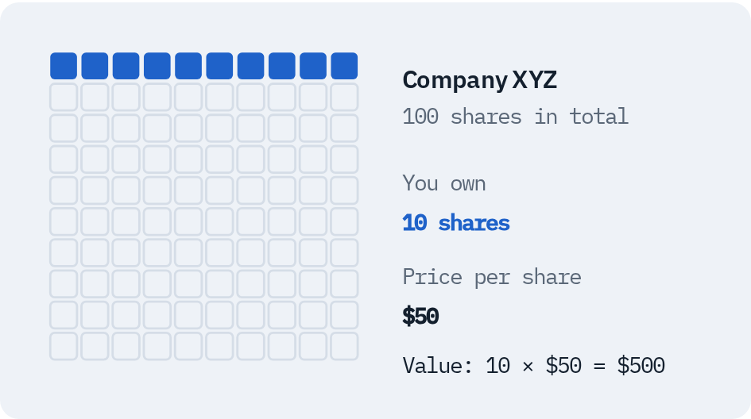

### 1.2 Why prices move (4 min)

- **Farm:** Wheat sells for more at the market when more bakers want it than farmers bring.
- **Goal:** The price is the last trade. When buyers are more eager than sellers, trades happen at higher prices.
- **Visual:** A price line above a bar chart of buy minus sell orders. The line rises on blue bars and falls on orange bars.
- **Try it:** Replay one trading day of the January 2021 squeeze at 1 minute per second.

### 1.3 Reading a price chart (4 min)

- **Farm:** A price chart is the market's record of what wheat sold for, day after day.
- **Goal:** Read open, high, low and close from a candle, and see a trend across days.
- **Visual:** One large labeled candle next to 18 days of small candles. Tap any candle to see its four prices.
- **Try it:** Scrub 30 days of the 2022 bear market and find the lowest close.

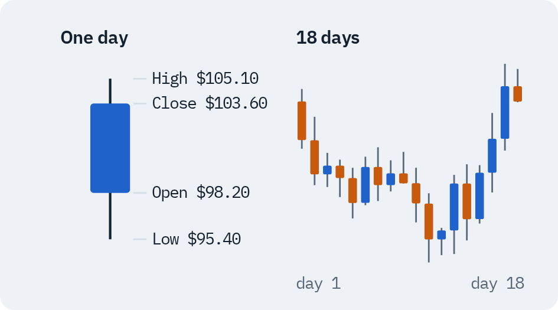

### 1.4 Bid, ask and spread (3 min)

- **Farm:** The grain dealer buys a little lower than they sell, and that gap is the cost of trading.
- **Goal:** You buy at the ask and sell at the bid, so every round trip costs the spread.
- **Visual:** A price ladder with bids below and asks above. The gap between the best bid and best ask is shaded as your cost.
- **Try it:** Buy and sell right away in a small company, then in a broad-market ETF, and compare the cost.

### 1.5 Market, limit and stop orders (5 min)

- **Farm:** A limit order says "sell my wheat only at $8 or more"; a stop says "sell it if the price falls to $6".
- **Goal:** A market order fills now, a limit order fills at your price or better, and a stop order sells after a drop.
- **Visual:** A price line with a buy-limit line and a sell-stop line. Dots show where each order filled, including a gap that fills below the stop.
- **Try it:** Set a stop in the March 2020 replay and see where it actually fills.

### 1.6 Gains, losses and percent (3 min)

- **Farm:** If a bad year halves the farm's value, it takes a doubled harvest to get back.
- **Goal:** Measure results in percent, and see why losses take more to win back.
- **Visual:** A curve of loss against the gain needed to get back to even: −10% needs +11%, −50% needs +100%.
- **Try it:** Read your percent return and the gain needed to recover on any replay result.

### 1.7 Diversification (4 min)

- **Farm:** A farm that grows wheat, corn and apples does not lose everything to one bad crop.
- **Goal:** Several unrelated holdings give the account a smoother path than any single stock.
- **Visual:** One stock's jagged line against a 10-stock portfolio's smoother line over the same 120 days.
- **Try it:** Play the 2000 dot-com replay twice: all in one tech stock, then spread across 8 sectors.

### 1.8 ETFs and index funds (3 min)

- **Farm:** An ETF is like a co-op that owns hundreds of farms; one share gives you a slice of all of them.
- **Goal:** One ETF ticker holds many companies, so one trade buys a diversified basket.
- **Visual:** One broad-market ETF split into its holdings: the 10 largest as big blocks and the other 490 as small cells.
- **Try it:** Buy a broad-market ETF in the live market and open its holdings list.

### 1.9 Position sizing (5 min)

- **Farm:** Plant only as much as you can afford to lose in one bad season.
- **Goal:** Decide how much you can lose before you buy: about 1 to 2% of the account per trade.
- **Visual:** A $10,000 account bar with the $100 at risk highlighted, and the math that turns a $2 stop distance into 50 shares.
- **Try it:** Use the size calculator on 3 trades in the 2022 replay.

### 1.10 Drawdowns (4 min)

- **Farm:** Drawdown is how far the farm's value falls from its best year before it recovers.
- **Goal:** Drawdown is the drop from the account's high point. Keeping it small keeps you in the game.
- **Visual:** An account value line with its largest peak-to-trough drop shaded and labeled in percent.
- **Try it:** Play March 2020 and read your max drawdown on the result card.

### 1.11 Compounding over time (4 min)

- **Farm:** Replanting seed from each harvest grows a bigger harvest every year.
- **Goal:** Gains left invested earn their own gains, so growth speeds up over the years.
- **Visual:** Two lines over 30 years at 7% a year: $1,000 left to compound against $1,000 with gains taken out each year.
- **Try it:** Drag the yearly return and years and watch the gap between the two lines.

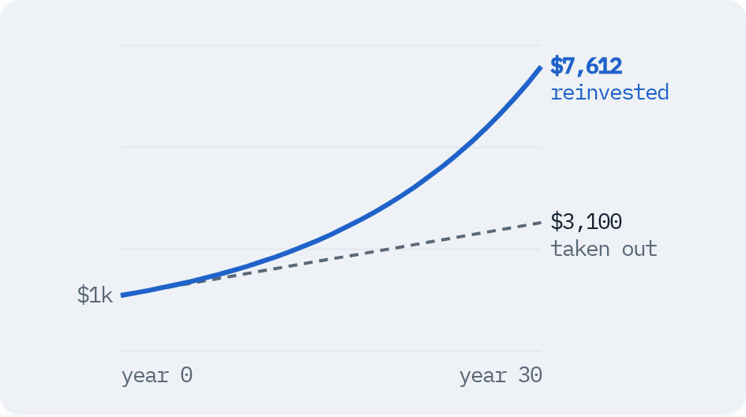

### Reality check: Why simulated prices differ (2 min)

Replay prices follow the shape and size of real events, not the exact daily numbers, so a real chart will show different prices.

### Gate to L2 (from spec)

- **Scenario:** March 2020 COVID crash and rebound
- **Quiz:** 10 to 15 questions from the L1 bank, pass at 80%
- **Challenge:** End with less than a 15% drawdown while holding at least three positions.
- Failed quizzes can be retaken after a short review. Levels never re-lock.

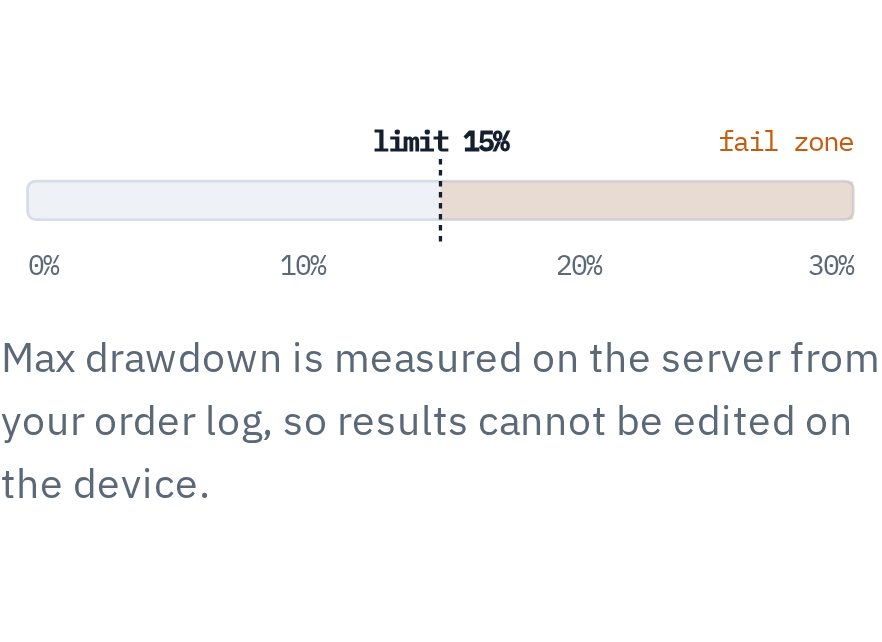

## L2: Covered calls and cash-secured puts

*After the L1 quiz and replay challenge. 8 lessons + 1 reality check, 35 min.*

Unlocks: Sell calls against 100 shares you own, and sell puts with the cash set aside.

### 2.1 What an option is (4 min)

- **Farm:** An option is a deal on 100 bushels: one side gets a choice, and the other side must honor it.
- **Goal:** An option is a contract on 100 shares. The buyer gets a right, and the seller takes on an obligation.
- **Visual:** A contract card with its five parts: stock, call or put, strike, expiry and price × 100.
- **Try it:** Open the option chain for any stock in the live market.

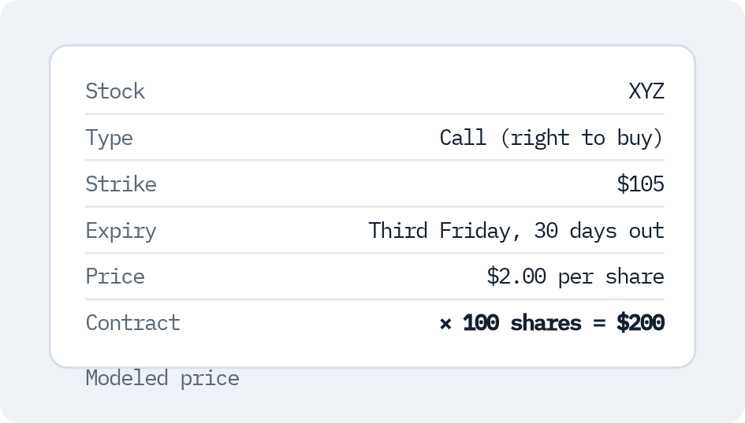

### 2.2 Strike, expiry and the chain (4 min)

- **Farm:** A chain is a menu of price locks: each row is a different locked price, each page a different harvest date.
- **Goal:** Read an option chain: strikes in rows, calls on one side, puts on the other, one expiry at a time.
- **Visual:** A five-row chain with in-the-money prices shaded and the stock price drawn between the rows.
- **Try it:** Find the strike closest to the stock price on 3 different stocks.

### 2.3 Premium (3 min)

- **Farm:** The premium is the fee for holding a price, and the seller keeps it whether the deal is used or not.
- **Goal:** Premium is the price of an option. The buyer pays it and the seller keeps it, whatever happens next.
- **Visual:** Cash moving from buyer to seller when the trade fills, and the two possible endings at expiry.
- **Try it:** Compare premiums one week and one month out on the same strike.

### 2.4 Calls and puts at expiry (4 min)

- **Farm:** At harvest, a price lock is worth the gap between the market price and the locked price, or nothing.
- **Goal:** At expiry a call is worth price minus strike, a put is worth strike minus price, and neither is worth less than zero.
- **Visual:** Value lines for a $100 call and a $100 put. Drag the expiry price and read what each contract is worth.
- **Try it:** Drag the price and predict each value before you read it.

### 2.5 The covered call (5 min)

- **Farm:** You own the harvest and sell a buyer the right to it at a set price, for a fee today.
- **Goal:** Selling a call on shares you own pays you now and caps your gain at the strike.
- **Visual:** Profit at expiry for 100 shares plus one short $105 call, drawn over the shares-only line. Drag the price to read profit.
- **Try it:** Sell one covered call a month in the 2022 replay.

### 2.6 The cash-secured put (5 min)

- **Farm:** You are paid a fee to promise to buy a neighbor's harvest at a set price, with the cash ready.
- **Goal:** Selling a put pays you now. If the price ends below the strike, you buy 100 shares at the strike.
- **Visual:** Profit at expiry for one short $95 put, with the $9,500 of cash it reserves.
- **Try it:** Sell a put below the market on a stock you would want to own, in the 2022 replay.

### 2.7 Assignment at expiry (4 min)

- **Farm:** On harvest day the deal settles, and the crop changes hands only if the lock is worth using.
- **Goal:** In-the-money options settle automatically at expiry, so know in advance what you will own or sell.
- **Visual:** Two branches at expiry for a covered call: price above the strike, price below it, and what happens to your shares and cash on each.
- **Try it:** Hold a covered call through expiry and watch the shares get called away.

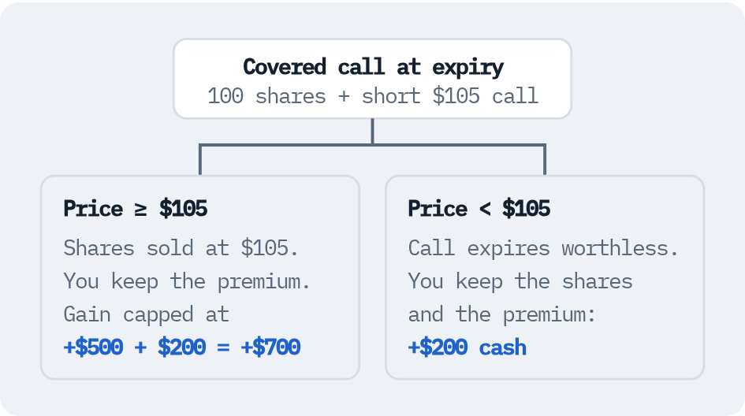

### 2.8 Income versus upside (4 min)

- **Farm:** Selling your harvest ahead at a set price pays steadily, but you miss out if prices soar.
- **Goal:** Selling options earns steady income in flat markets and gives up gains in strong rallies.
- **Visual:** Shares alone against shares with monthly covered calls, in a rally and in a flat market.
- **Try it:** Run the same covered-call plan in the March 2020 rebound and in the 2022 bear market.

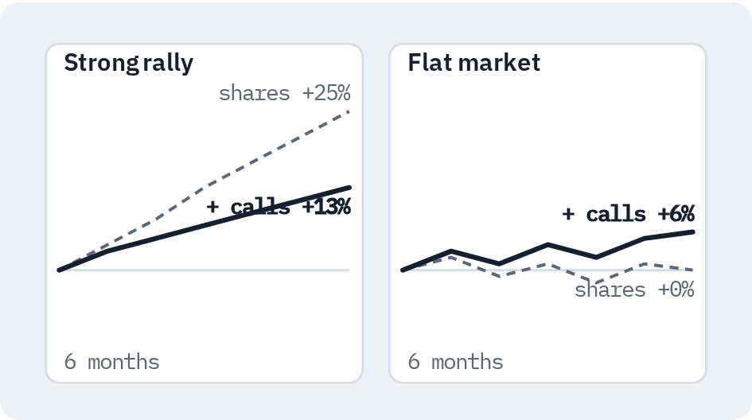

### Reality check: Early assignment (2 min)

Real US stock options can be assigned before expiry, most often just before a dividend. Version 1 settles only at expiry.

### Gate to L3 (proposed)

- **Scenario:** 2022 rate-hike bear market
- **Quiz:** 10 to 15 questions from the L2 bank, pass at 80%
- **Challenge:** Sell at least 4 covered calls or cash-secured puts and finish with a smaller drawdown than holding the broad-market ETF alone.
- Failed quizzes can be retaken after a short review. Levels never re-lock.

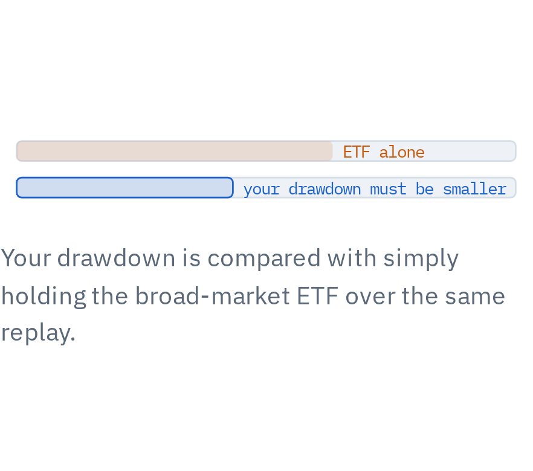

## L3: Long calls and puts

*After the L2 quiz and replay challenge. 8 lessons + 1 reality check, 34 min.*

Unlocks: Buy calls and puts.

### 3.1 Buying a call (4 min)

- **Farm:** A call is a small deposit that locks today's wheat price for later.
- **Goal:** A long call profits above strike plus premium, and the most you can lose is the premium.
- **Visual:** Profit at expiry for one $100 call bought for $4, with the breakeven at $104. Drag the price to read profit.
- **Try it:** Buy a call in the March 2020 rebound.

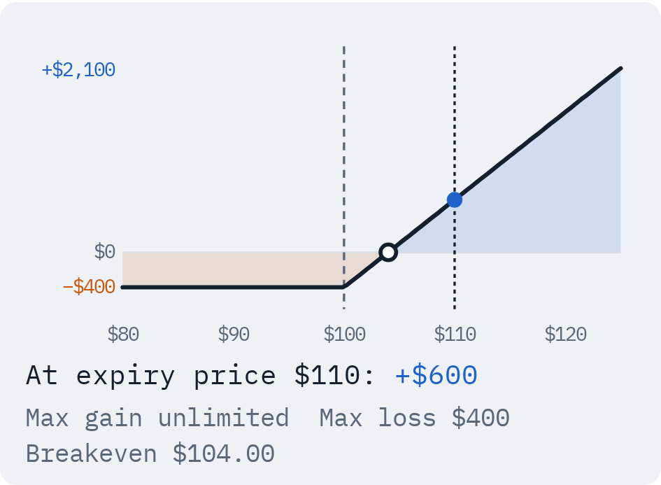

### 3.2 Buying a put (4 min)

- **Farm:** A put is crop insurance: it pays when the price falls.
- **Goal:** A long put profits below strike minus premium, and it can protect shares you already own.
- **Visual:** Profit at expiry for one $100 put bought for $4, with the breakeven at $96.
- **Try it:** Buy a put on shares you hold before the March 2020 drop.

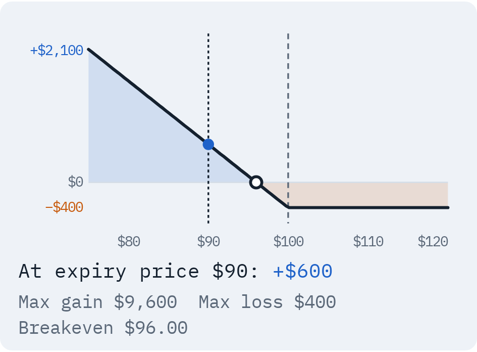

### 3.3 Leverage (4 min)

- **Farm:** A small deposit controls a whole harvest, so a small price move swings the deposit a lot.
- **Goal:** The same dollars in options move many times faster than in shares, in both directions.
- **Visual:** $1,000 in shares against $1,000 in calls, held to expiry, after the stock moves −10%, 0% and +10%.
- **Try it:** Split $2,000 between shares and calls in the meme-stock replay and compare.

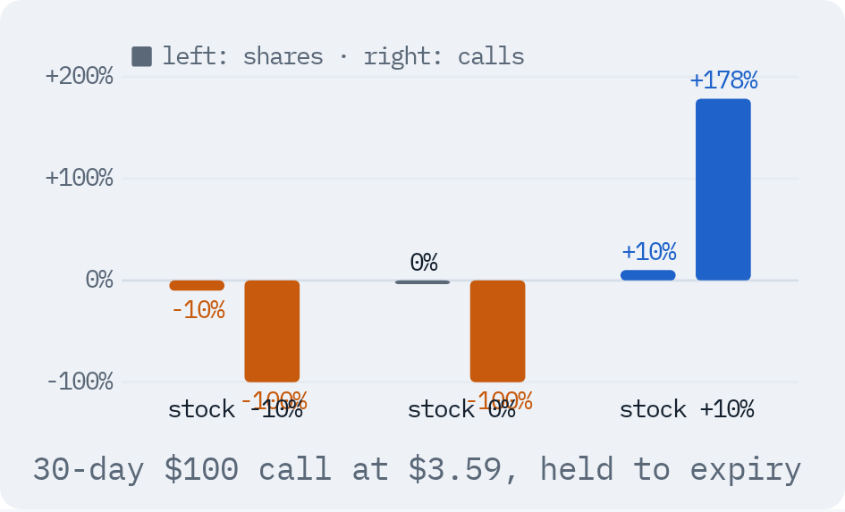

### 3.4 Time decay (4 min)

- **Farm:** A price lock loses value as harvest day gets closer, and fastest in the final weeks.
- **Goal:** An option loses value every day, and the loss speeds up in the last month.
- **Visual:** The price of a 90-day at-the-money call as the days run out. Drag the days left and read the daily loss.
- **Try it:** Hold the same call for 30 days in a flat replay and watch its value drop.

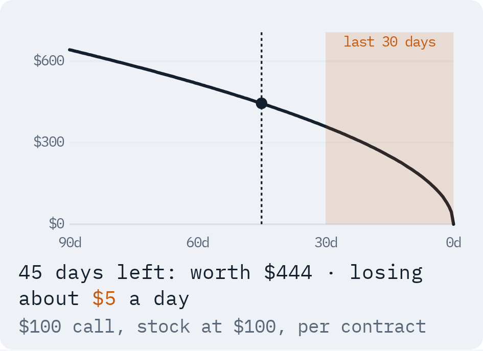

### 3.5 Implied volatility (4 min)

- **Farm:** Crop insurance costs more in a stormy year, when everyone expects big price swings.
- **Goal:** Options cost more when the market expects big moves, and get cheaper when that fear fades.
- **Visual:** The price of the same 30-day call at different volatility levels, from a calm market to the March 2020 peak.
- **Try it:** Price one call before and after the March 2020 volatility peak.

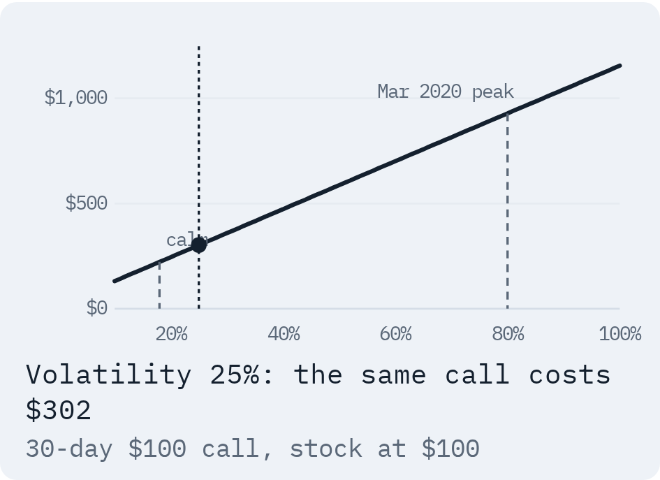

### 3.6 Delta (4 min)

- **Farm:** Delta is how much your price lock gains when wheat rises $1 a bushel.
- **Goal:** Delta is how many dollars the option moves when the stock moves $1.
- **Visual:** Delta of a $100 call across stock prices, from near 0 to near 1. Drag the stock price and read delta.
- **Try it:** Read delta on 3 strikes, then predict how each moves on the next bar.

### 3.7 The greeks on one card (4 min)

- **Farm:** The greeks tell you what moves your price lock: the wheat price, its speed, the days left and the weather.
- **Goal:** Read delta, gamma, theta and vega together to see what will move your position most.
- **Visual:** One position card with all four greeks, each written as dollars per contract.
- **Try it:** Open the greeks card on every position during one replay.

### 3.8 Why most short-dated options expire worthless (4 min)

- **Farm:** Insurance against a once-in-a-lifetime frost is cheap because the frost almost never comes.
- **Goal:** A far out-of-the-money option with a week left needs a large move, and large moves are rare.
- **Visual:** The spread of likely prices one week out, with the small area above a $110 strike shaded and its probability shown.
- **Try it:** Buy a cheap one-week call and follow it to expiry.

### Reality check: How real option chains differ (2 min)

Replay option prices come from a model and carry a Modeled badge. Real chains are set by traders and have wider spreads on thinly traded strikes.

### Gate to L4 (proposed)

- **Scenario:** January 2021 meme-stock squeeze
- **Quiz:** 10 to 15 questions from the L3 bank, pass at 80%
- **Challenge:** Trade calls or puts with no more than 5% of the account in any one trade, and finish with less than a 10% drawdown.
- Failed quizzes can be retaken after a short review. Levels never re-lock.

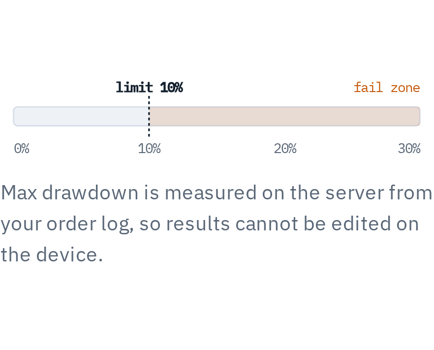

## L4: Spreads

*After the L3 quiz and replay challenge. 6 lessons + 1 reality check, 28 min.*

Unlocks: Vertical debit and credit spreads. Iron condors and calendars come in a later release.

### 4.1 What a spread is (4 min)

- **Farm:** A spread buys one price lock and sells another to cut the cost.
- **Goal:** A spread buys one option and sells another on the same stock, which caps both the loss and the gain.
- **Visual:** A long $100 call and a short $110 call drawn thin, and their sum drawn thick: a line with a floor and a ceiling.
- **Try it:** Build your first spread in the order ticket and read its max loss before sending.

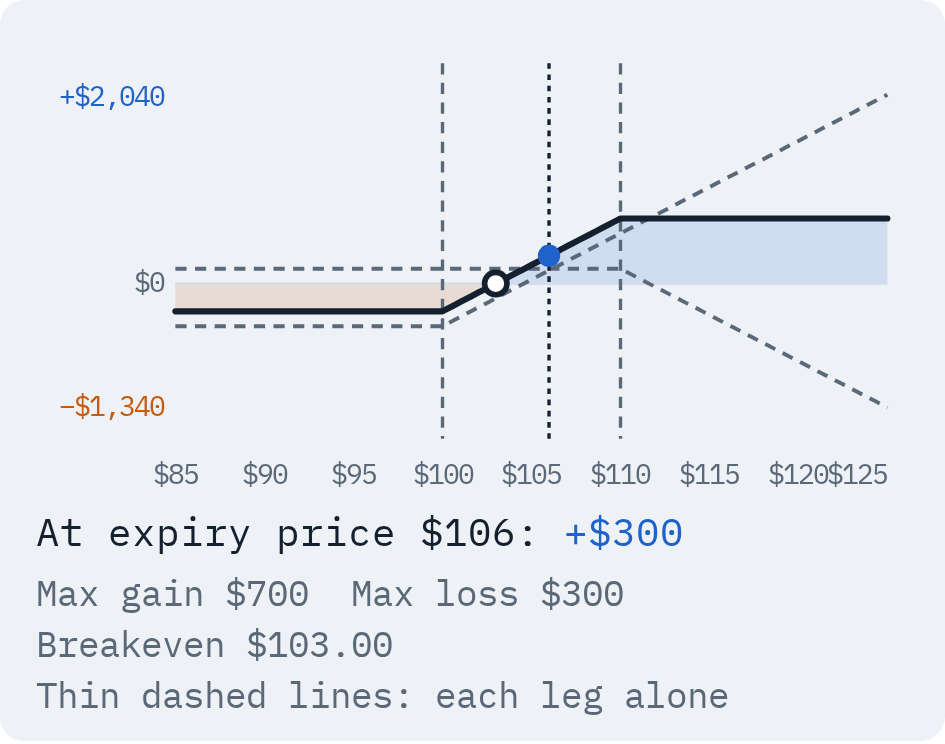

### 4.2 The bull call spread (5 min)

- **Farm:** Lock in the right to buy at $10 and sell someone the right to buy at $11: cheaper, but your gain stops at $11.
- **Goal:** Pay a debit to profit from a rise, with max loss, max gain and breakeven known before you trade.
- **Visual:** Profit at expiry for a $100/$110 call spread bought for $3.00.
- **Try it:** Open a bull call spread in the March 2020 rebound.

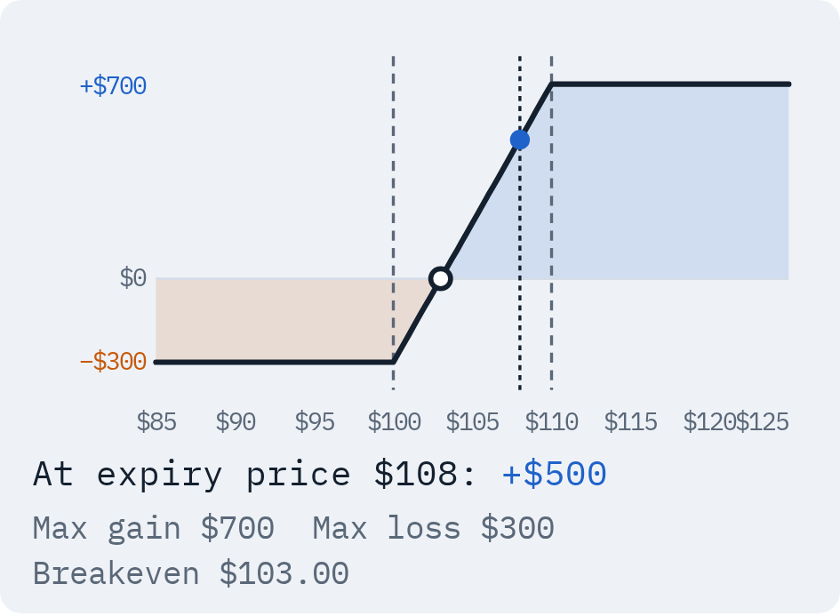

### 4.3 The bear put spread (4 min)

- **Farm:** Buy crop insurance at $10 and sell insurance at $9: cheaper cover for the drop in between.
- **Goal:** Pay a debit to profit from a fall, for less than a single put costs.
- **Visual:** Profit at expiry for a $100/$90 put spread bought for $2.80.
- **Try it:** Open a bear put spread in the 2008 financial crisis replay.

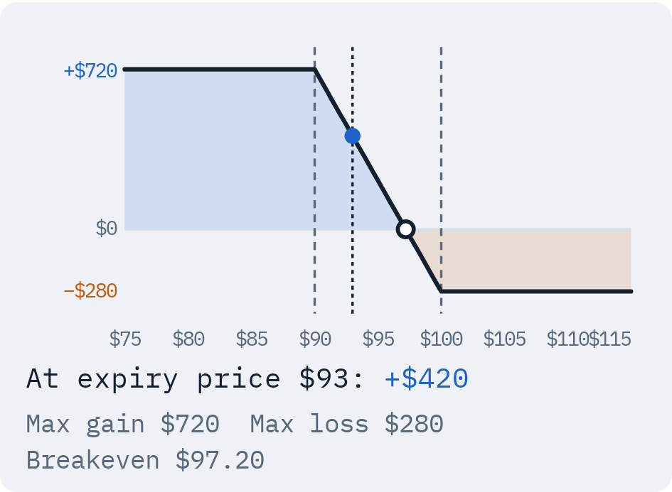

### 4.4 Credit spreads (5 min)

- **Farm:** Sell insurance and buy cheaper insurance behind it: you collect a fee, and your worst case is capped.
- **Goal:** Sell a spread to collect a credit now. The cash reserved equals your maximum loss.
- **Visual:** Profit at expiry for a $95/$90 put spread sold for $1.40, with $360 of cash reserved.
- **Try it:** Sell a put credit spread below the market in the 2022 replay.

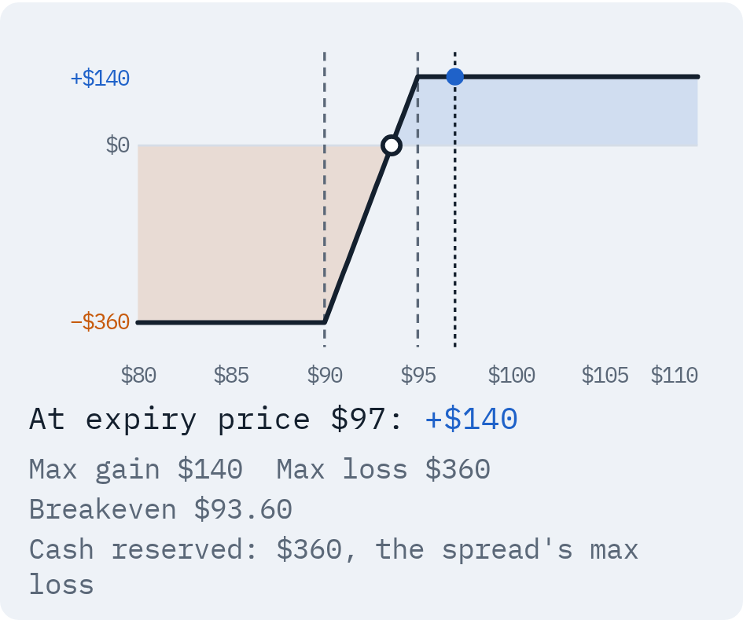

### 4.5 Choosing strikes (4 min)

- **Farm:** A wider gap between the two locked prices costs more and can pay more.
- **Goal:** A wider spread can earn more but costs and risks more. Pick the width by how much you can lose.
- **Visual:** A call spread whose upper strike you drag from $105 to $120. Cost, max gain and max loss update as it widens.
- **Try it:** Price three widths on the same stock and pick one that fits your 2% risk limit.

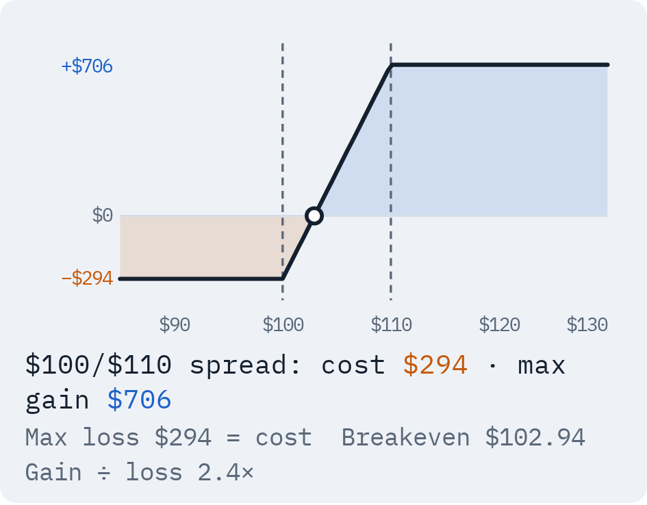

### 4.6 Managing and closing early (4 min)

- **Farm:** You do not have to wait for harvest day: sell the deal early once it has paid enough.
- **Goal:** Close at a planned profit or loss instead of waiting for expiry.
- **Visual:** The spread's value today drawn as a curve over its value at expiry. Drag the days left and watch the curve settle onto the expiry line.
- **Try it:** Set a 50% profit target and close a spread early in the 2022 replay.

### Reality check: Defined risk is not no risk (2 min)

A spread tells you the worst case before you trade. It does not make the worst case unlikely, so size it like any other trade.

### Final challenge (Level 4 badge) (proposed)

- **Scenario:** 2008 financial crisis
- **Quiz:** 10 to 15 questions from the L4 bank, pass at 80%
- **Challenge:** Use only defined-risk trades, risk no more than 3% of the account per trade, and finish with less than a 12% drawdown.
- Failed quizzes can be retaken after a short review. Levels never re-lock.

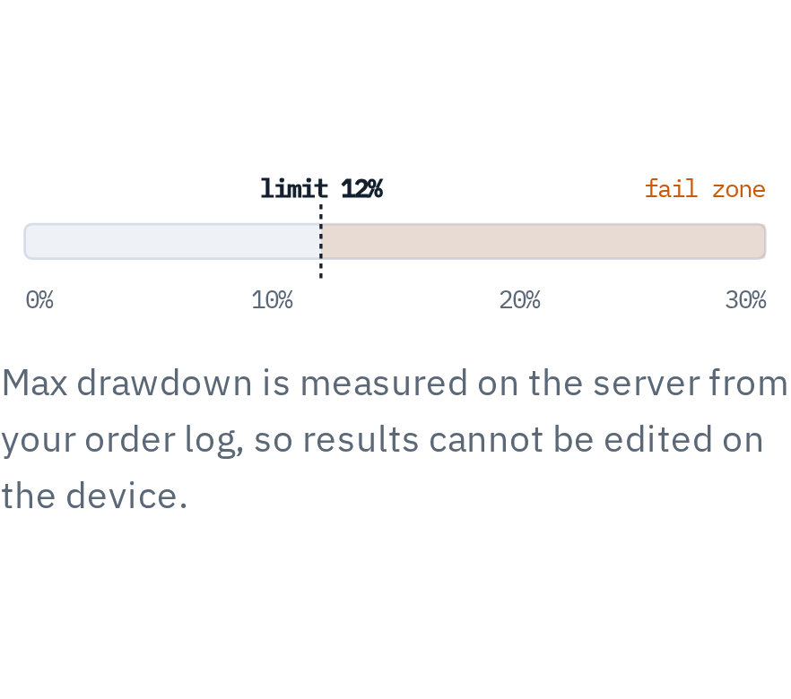

## Glossary

| Term | Meaning | Think of it like | Lesson |
|---|---|---|---|
| Share | One unit of ownership in a company. | A slice of the farm and its future harvests. | 1.1 |
| Bid and ask | The highest price a buyer offers and the lowest price a seller accepts. | What the grain dealer pays you, and what they charge you. | 1.4 |
| Bid-ask spread | The gap between bid and ask, paid on every round trip. | The grain dealer's cut. | 1.4 |
| Market order | Buy or sell now at the best available price. | Sell the wheat at today's market price, whatever it is. | 1.5 |
| Limit order | Buy or sell only at your price or better. | Sell the wheat only at $8 a bushel or more. | 1.5 |
| Stop order | Sell once the price falls to a level you set. | Sell the wheat if the price drops to $6. | 1.5 |
| Diversification | Owning several unrelated holdings to smooth the path. | Growing wheat, corn and apples instead of one crop. | 1.7 |
| ETF | One fund, traded under one ticker, that holds many companies. | A co-op that owns hundreds of farms. | 1.8 |
| Position size | How much you put into one trade, set by how much you can lose. | How many acres you plant with one crop. | 1.9 |
| Drawdown | The drop from the account's high point to its low point. | How far the farm's value falls from its best year. | 1.10 |
| Compounding | Gains that stay invested and earn their own gains. | Replanting seed from each harvest. | 1.11 |
| Option | A contract on 100 shares that gives the buyer a right and the seller an obligation. | A deal on 100 bushels. | 2.1 |
| Call | The right to buy at the strike price until expiry. | A deposit that locks today's wheat price. | 3.1 |
| Put | The right to sell at the strike price until expiry. | Crop insurance against a price drop. | 3.2 |
| Strike | The price written into the option. | The locked price per bushel. | 2.2 |
| Expiry | The last day the option exists. | Harvest day, when the deal settles. | 2.2 |
| Premium | The price of an option, paid by the buyer to the seller. | The fee for holding a price. | 2.3 |
| In the money | An option that would be worth something if it settled now. | A price lock that beats the market price. | 2.2 |
| Covered call | Selling a call on 100 shares you own. | Selling a buyer the right to your harvest at a set price. | 2.5 |
| Cash-secured put | Selling a put with the cash set aside to buy the shares. | Being paid to promise to buy a neighbor's harvest at a set price. | 2.6 |
| Assignment | The seller fulfilling the contract when an in-the-money option settles. | The crop changing hands on harvest day. | 2.7 |
| Breakeven | The price at which a trade neither makes nor loses money. | The wheat price at which the deal just pays for its fee. | 3.1 |
| Leverage | Controlling more value than the money you put in. | A small deposit that controls a whole harvest. | 3.3 |
| Time decay (theta) | The value an option loses each day. | A price lock that weakens as harvest day nears. | 3.4 |
| Implied volatility | How big a move the market expects, built into option prices. | How stormy the year looks. | 3.5 |
| Delta | How many dollars an option moves for a $1 move in the stock. | How much your price lock gains when wheat rises $1. | 3.6 |
| Gamma | How fast delta changes as the stock moves. | How quickly your price lock gets more sensitive. | 3.7 |
| Vega | How much an option's price changes when implied volatility moves 1 point. | How much insurance prices jump when storms are forecast. | 3.7 |
| Spread | Buying one option and selling another on the same stock. | Buying one price lock and selling another to cut the cost. | 4.1 |
| Debit spread | A spread you pay for up front. | Paying a smaller fee for a price lock with a ceiling. | 4.2 |
| Credit spread | A spread you are paid for up front, with the max loss held as cash. | Selling insurance with cheaper insurance bought behind it. | 4.4 |
| Max loss and max gain | The worst and best results a trade can have, known before you trade. | The floor and the ceiling on the deal. | 4.2 |

## Notes

- Gates marked proposed are new in this plan; only the L1 gate comes from the spec.
- Diagram numbers are worked examples: option prices use Black-Scholes, 30% volatility, 4% rate unless noted.
- All lesson text will be written and reviewed by people; AI is used only for debriefs.
