# Trading Simulator Lesson Plan

Draft for review, Nov 27, 2026. Updated Nov 28, 2026 with the review refinements Prafull decided that day (R1 to R31 in the [spec](spec.md#review-refinements-nov-28-2026)). The six investing-track diagrams and the coverage map were drawn on Nov 28; the 38 level diagrams did not need redrawing, because none of them shows anything the review changed. Visual version: see the published page.

**4 levels and an investing track · 44 lessons · 10 reality checks · about 195 minutes of reading · 3 to 5 minutes per lesson**

## Every lesson

1. **Read with the diagram** (2 to 3 min): short text beside one interactive diagram; new terms in bold with a one-line definition.
2. **Check** (1 min): two or three questions answered on the diagram itself.
3. **Try it** (2 to 5 min): a concept replay of 20 to 60 bars, real tickers, simulated prices. It is never the live market, so it works at any hour. Where a "Try it" names an event, it means a cut from one of that event's practice variants, never the path a gate uses. Longer ones use the fast speeds (one day per 1 or 3 seconds) and "Skip to next event".
4. **Debrief** (after replays): rule-based findings on every replay name what went well, up to three mistakes and one lesson to study next. AI puts them in a coach's words once a day.

## How the visuals teach

- One goal per lesson, in one sentence. If it needs two, it becomes two lessons.
- One diagram per lesson, with labeled axes and real dollar amounts. Explain by pointing at the chart.
- One running analogy, a farm and its harvest, opens each lesson in a single line; then real tickers and numbers. No other metaphors.
- Same marks everywhere: one gain color, one loss color, dashed line is a strike, a ring is a breakeven.
- The gain and loss colors come from the market pack: blue and orange in the US pack, both color-blind safe. Lesson text never names a color, because rise and fall colors differ by market. Every value is also printed as a signed number.
- Dollar amounts and the farm's crops are values the market pack fills in, so a later market can say ¥1,000,000 and rice without a rewrite. This plan shows the US pack.
- Every diagram responds to touch: drag price, days left or strike and numbers update.
- Every price is labeled Simulated price; every option price Modeled.

## The learning loop

What surrounds the lessons. All of it was accepted on Nov 28, 2026 (R6, R8, R9, R26, R29).

- **Placement check.** An optional 10 questions from the Level 1 bank, offered on Home ("Already know the basics?"). Lessons whose questions the learner gets right are marked as known and can be skipped; the gate quiz and challenge still apply. The same bank asked again at the end of the level gives a learning-gain number.
- **Spaced review.** Check and quiz questions a learner misses come back in a review set of three to five questions some days later, and again after a longer gap if missed again.
- **A plan before the trade.** Lesson 1.13 teaches deciding the loss before buying. The ticket offers an optional plan picked from choices, never typed: a reason, a target, an exit and a horizon. The debrief compares the plan with what the learner did.
- **A scorecard for your own calls.** Each planned trade is graded at the horizon the learner chose, on its return in excess of the broad-market ETF: how often the calls beat the benchmark, and how large the wins were against the losses. Lesson 1.12 teaches judging against a benchmark; this applies it to every plan.
- **Limits you set yourself.** After lesson 1.13 the learner can set their own limits: largest position, largest sector, and a drawdown at which to pause. The ticket names any limit an order would break and lets the learner change the order or place it anyway, and the debrief lists each time a limit held or was overridden.
- **A debrief on every replay.** Mistakes the server can find by rule are shown after every replay with the lesson that covers each one. AI puts them in a coach's words once a day.

## L1: Stocks and ETFs

*Open to everyone at signup. 16 lessons + 5 reality checks, 70 min.*

Unlocks: Buy and sell shares and ETFs with market, limit and stop orders.

### 1.1 What a share is (3 min)

- **Farm:** Owning a share is like owning a slice of a farm: you get a piece of every future harvest.
- **Goal:** A share is one small piece of a company, and your holding is worth shares × price.
- **Visual:** A company drawn as 100 squares with 10 of them yours. Change the price and the value of your 10 squares updates.
- **Try it:** Buy 10 shares of any stock in a 20-day concept replay and watch your position value change.

### 1.2 Why prices move (4 min)

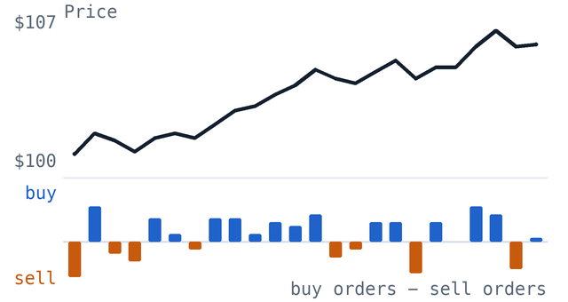

- **Farm:** Wheat sells for more at the market when more bakers want it than farmers bring.
- **Goal:** The price is the last trade. When buyers are more eager than sellers, trades happen at higher prices.
- **Visual:** A price line above a bar chart of buy minus sell orders. The line rises on gain-colored bars and falls on loss-colored bars.
- **Try it:** Replay 60 one-minute bars of a busy morning in the January 2021 squeeze.

### 1.3 Dividends and earnings (4 min) (new)

- **Farm:** Some farms pay out part of every harvest in cash, while others replant it all to grow bigger.
- **Goal:** Your return is the price change plus any dividends, and over time prices follow earnings.
- **Visual:** Two bars for one year on $1,000: a stock that replants every dollar grows by price alone, while a dividend payer adds cash on top. A slider sets the dividend yield.
- **Try it:** Hold a dividend-paying stock through one replay year at one day per second, skipping to each dividend date, and read its total return.

### 1.4 Reading a price chart (4 min)

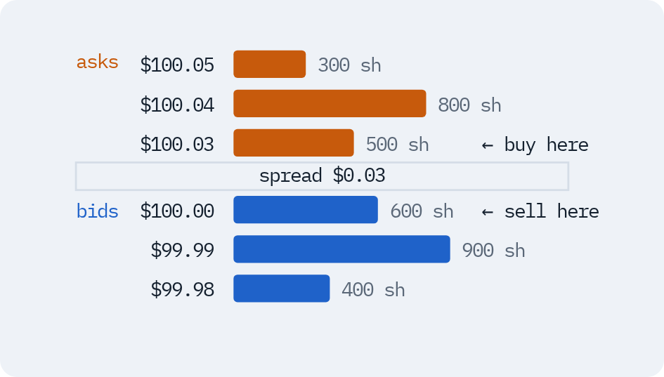

- **Farm:** A price chart is the market's record of what wheat sold for, day after day.
- **Goal:** Read open, high, low and close from a candle, and see a trend across days.
- **Visual:** One large labeled candle next to 18 days of small candles. Tap any candle to see its four prices.
- **Try it:** Scrub 30 days of the 2022 bear market and find the lowest close.

### 1.5 Bid, ask and spread (3 min)

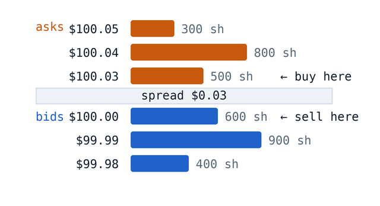

- **Farm:** The grain dealer buys a little lower than they sell, and that gap is the cost of trading.
- **Goal:** You buy at the ask and sell at the bid, so every round trip costs the spread. Thinly traded stocks have wider spreads and are harder to sell quickly.
- **Visual:** A price ladder with bids below and asks above. The gap between the best bid and best ask is shaded as your cost. A slider switches from a busy stock to a thinly traded one, and the gap widens.
- **Try it:** Buy and sell right away in a small company, then in a broad-market ETF, and compare the cost.

### 1.6 Market, limit and stop orders (5 min)

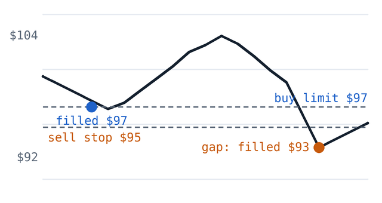

- **Farm:** A limit order says "sell my wheat only at $8 or more"; a stop says "sell it if the price falls to $6".
- **Goal:** A market order fills now, a limit order fills at your price or better, and a stop order sells after a drop.
- **Visual:** A price line with a buy-limit line and a sell-stop line. Dots show where each order filled, including a gap that fills below the stop.
- **Try it:** Set a stop in the March 2020 replay and see where it actually fills.

### 1.7 Gains, losses and percent (3 min)

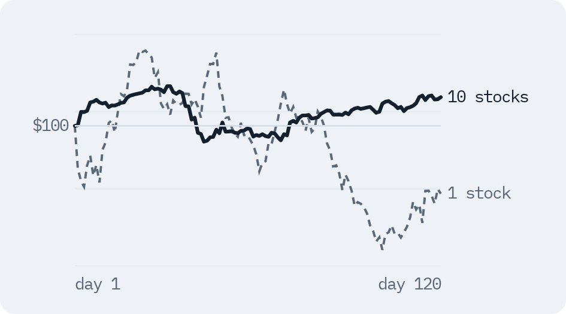

- **Farm:** If a bad year halves the farm's value, it takes a doubled harvest to get back.
- **Goal:** Measure results in percent, and see why losses take more to win back.
- **Visual:** A curve of loss against the gain needed to get back to even: −10% needs +11%, −50% needs +100%.
- **Try it:** Read your percent return and the gain needed to recover on any replay result.

### 1.8 Diversification (4 min)

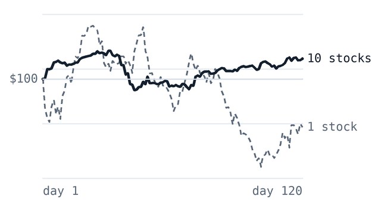

- **Farm:** A farm that grows wheat, corn and apples does not lose everything to one bad crop.
- **Goal:** Several unrelated holdings give the account a smoother path than any single stock.
- **Visual:** One stock's jagged line against a 10-stock portfolio's smoother line over the same 120 days.
- **Try it:** Play a 60-day cut of the 2000 dot-com bust twice: all in one tech stock, then spread across 8 sectors.

### 1.9 Risk and return (4 min) (new)

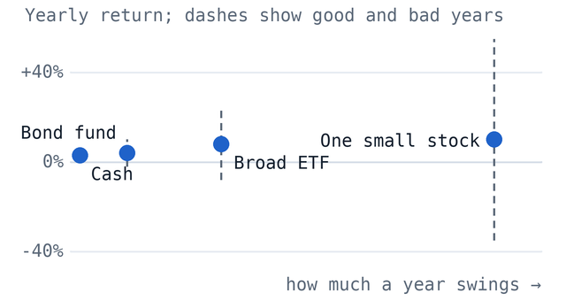

- **Farm:** A grain store pays a little every year, while a new orchard might pay a lot or nothing at all.
- **Goal:** Riskier investments are expected to pay more over time, and their results swing more widely.
- **Visual:** Cash, a bond fund, a broad-market ETF and one small stock as dots of yearly return against the size of their swings.
- **Try it:** Compare a broad-market ETF and one small stock over the same 2008 replay.

### 1.10 ETFs and index funds (3 min)

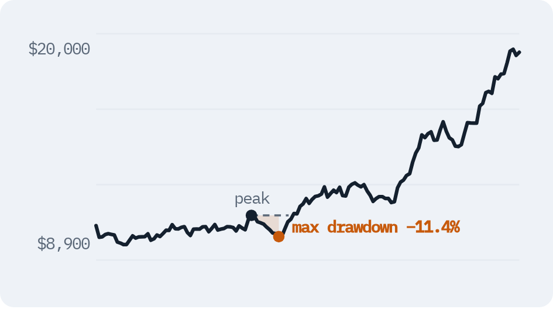

- **Farm:** An ETF is like a co-op that owns hundreds of farms; one share gives you a slice of all of them.
- **Goal:** One ETF ticker holds many companies, so one trade buys a diversified basket.
- **Visual:** One broad-market ETF split into its holdings: the 10 largest as big blocks and the other 490 as small cells.
- **Try it:** Buy a broad-market ETF in a concept replay and open its holdings list.

### 1.11 Fees and expense ratios (3 min) (new)

- **Farm:** A co-op that keeps 1% of every harvest takes far more over 30 years than one that keeps 0.05%.
- **Goal:** Fund fees come out every year, so a small fee compounds into a large gap.
- **Visual:** $10,000 over 30 years at 7%, after a 0.05% fee and after a 1% fee, with the dollar gap printed. A slider changes the second fund's fee.
- **Try it:** Compare two funds' expense ratios in the fund screen and project the gap over 30 years.

### 1.12 Indexes and benchmarks (3 min) (new)

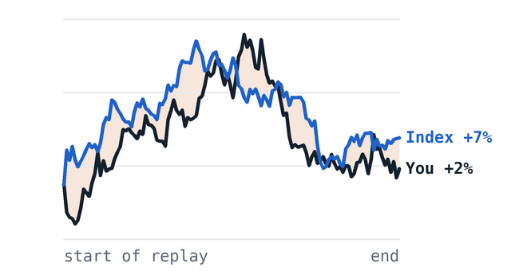

- **Farm:** A harvest is only a good one if it beats what the whole valley grew that year.
- **Goal:** Judge your results against an index such as the S&P 500, not against zero.
- **Visual:** Your replay account line against the broad-market index line, with the gap between them shaded.
- **Try it:** Finish any replay and read your result against the broad-market index on the result card.

### 1.13 Position sizing (5 min)

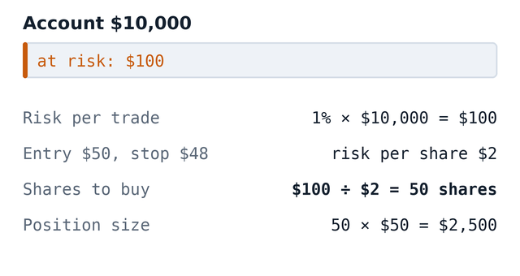

- **Farm:** Plant only as much as you can afford to lose in one bad season.
- **Goal:** Start from your own risk tolerance, then decide how much you can lose before you buy: about 1 to 2% of the account per trade.
- **Visual:** A five-question risk-tolerance check sets your starting risk, then a $10,000 account bar with the $100 at risk highlighted, and the math that turns a $2 stop distance into 50 shares.
- **Try it:** Use the size calculator on 3 trades in the 2022 replay.

### 1.14 Drawdowns (4 min)

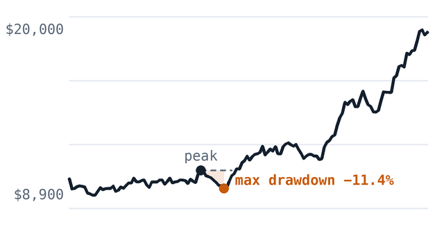

- **Farm:** Drawdown is how far the farm's value falls from its best year before it recovers.
- **Goal:** Drawdown is the drop from the account's high point. Keeping it small keeps you in the game.
- **Visual:** An account value line with its largest peak-to-trough drop shaded and labeled in percent.
- **Try it:** Play March 2020 and read your max drawdown on the result card.

### 1.15 Your own biases (4 min) (new)

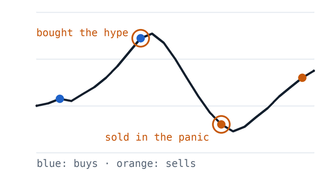

- **Farm:** A farmer who always plants whatever sold best last year is always one season late.
- **Goal:** Loss aversion and chasing hot stocks lead to buying high and selling low.
- **Visual:** Your own buys and sells from a replay, marked on its price line, with the high-buy and low-sell trades circled.
- **Try it:** Review the trades from your most recent replay and tag each one as planned or impulse.

### 1.16 Compounding over time (4 min)

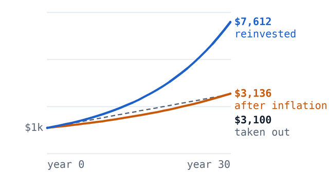

- **Farm:** Replanting seed grows a bigger harvest every year, but if bread costs 3% more each year, the harvest has to grow faster than that.
- **Goal:** Gains left invested earn their own gains, so growth speeds up over the years. Inflation means real growth is your return minus inflation.
- **Visual:** Three lines over 30 years at 7% a year: $1,000 left to compound, the same money after 3% inflation, and $1,000 with gains taken out each year.
- **Try it:** Drag the yearly return and years and watch the gap between the two lines.

### Reality check: Why simulated prices differ (2 min)

Replay prices follow the shape and size of real events, not the exact daily numbers, so a real chart will show different prices. Real exchanges also keep hours: US stocks trade from 9:30 AM to 4 PM Eastern on weekdays, and a price can jump between one day's close and the next day's open. The app's live market is simulated and always open.

### Reality check: Spotting investment scams (2 min) (new)

Promises of guaranteed returns, pressure to act now and pump-and-dump hype on social media are red flags. Real money never needs to move to learn here.

### Reality check: Taxes on gains (2 min) (new)

In a real account, gains and dividends are taxed, and gains on holdings sold within a year are usually taxed more. The simulator shows results before tax. This is the US wording; each market pack carries its own.

### Reality check: Settlement and day-trading rules (2 min) (new)

In a real account the money from a sale takes a business day to settle, and brokers limit frequent day trading in small accounts. The simulator settles at once. The lesson is checked against the current FINRA and SEC rules when it is drafted.

### Reality check: Margin and short selling (2 min) (new)

Borrowing to buy more, and selling shares you do not own, both exist in real accounts and both can lose more than you put in. The app teaches the ideas and offers neither.

### Gate to L2

- **Scenario:** A held-out variant of the March 2020 COVID crash and rebound, one the learner has not played
- **Quiz:** 10 to 15 questions from the L1 bank, pass at 80%
- **Challenge:** Stay at least 50% invested on average, hold at least three positions with no single stock above 25% of the account, and finish with a smaller max drawdown than the broad-market ETF.
- Failed quizzes can be retaken after a short review. Levels never re-lock.

## L2: Covered calls and cash-secured puts

*After the L1 quiz and replay challenge. 8 lessons + 1 reality check, 35 min. Replays from this level up start with $100,000 of simulated money, so 100 shares or one cash-secured put stays near a tenth of the account.*

Unlocks: Sell calls against 100 shares you own, and sell puts with the cash set aside.

### 2.1 What an option is (4 min)

- **Farm:** An option is a deal on 100 bushels: one side gets a choice, and the other side must honor it.
- **Goal:** An option is a contract on 100 shares. The buyer gets a right, and the seller takes on an obligation.
- **Visual:** A contract card with its five parts: stock, call or put, strike, expiry and price × 100.
- **Try it:** Open the option chain for any stock in a concept replay.

### 2.2 Strike, expiry and the chain (4 min)

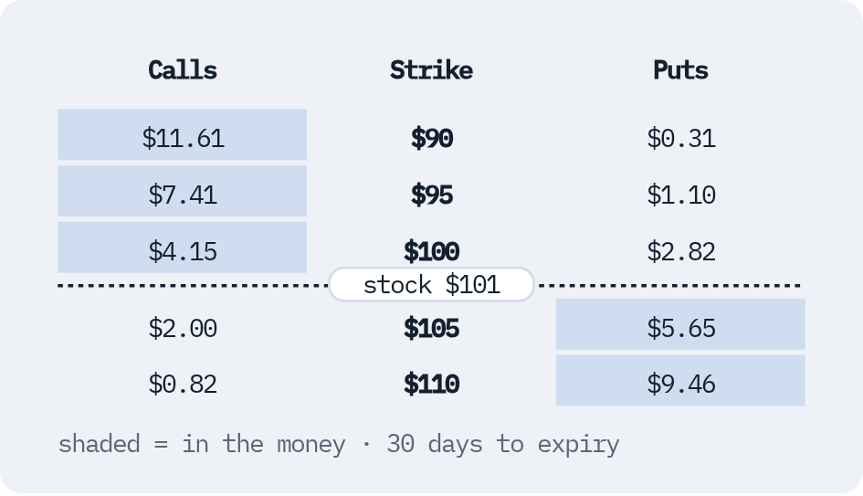

- **Farm:** A chain is a menu of price locks: each row is a different locked price, each page a different harvest date.
- **Goal:** Read an option chain: strikes in rows, calls on one side, puts on the other, one expiry at a time.
- **Visual:** A five-row chain with in-the-money prices shaded and the stock price drawn between the rows.
- **Try it:** Find the strike closest to the stock price on 3 different stocks.

### 2.3 Premium (3 min)

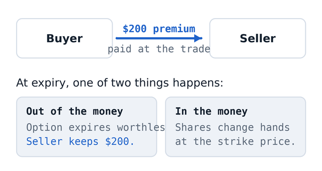

- **Farm:** The premium is the fee for holding a price, and the seller keeps it whether the deal is used or not.
- **Goal:** Premium is the price of an option. The buyer pays it and the seller keeps it, whatever happens next.
- **Visual:** Cash moving from buyer to seller when the trade fills, and the two possible endings at expiry.
- **Try it:** Compare premiums one week and one month out on the same strike.

### 2.4 Calls and puts at expiry (4 min)

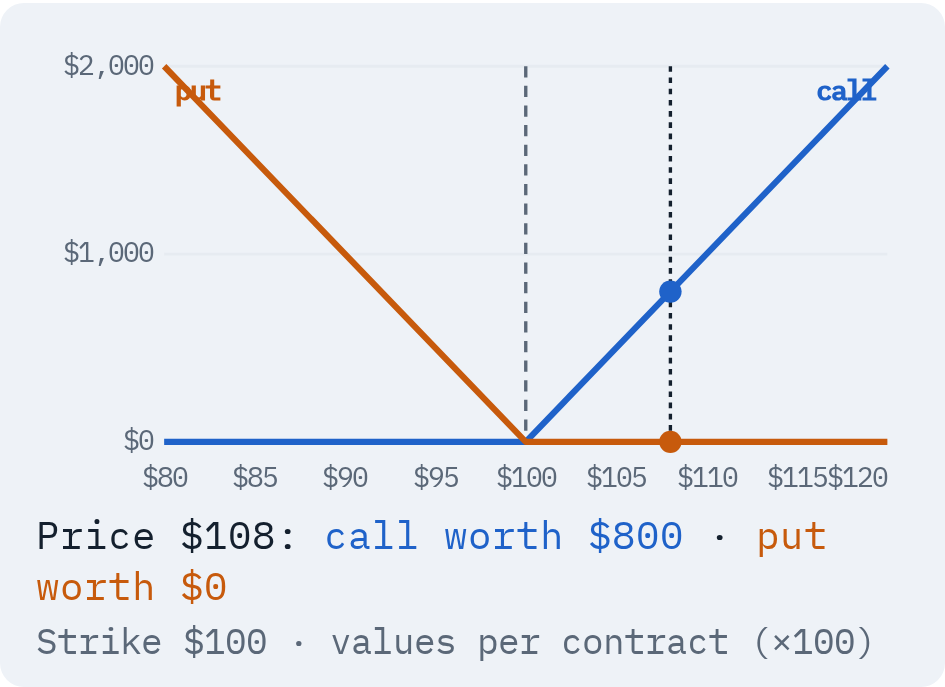

- **Farm:** At harvest, a price lock is worth the gap between the market price and the locked price, or nothing.
- **Goal:** At expiry a call is worth price minus strike, a put is worth strike minus price, and neither is worth less than zero.
- **Visual:** Value lines for a $100 call and a $100 put. Drag the expiry price and read what each contract is worth.
- **Try it:** Drag the price and predict each value before you read it.

### 2.5 The covered call (5 min)

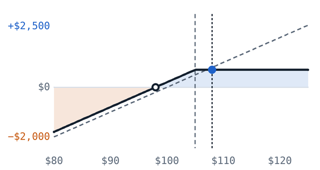

- **Farm:** You own the harvest and sell a buyer the right to it at a set price, for a fee today.
- **Goal:** Selling a call on shares you own pays you now and caps your gain at the strike.
- **Visual:** Profit at expiry for 100 shares plus one short $105 call, drawn over the shares-only line. Drag the price to read profit.
- **Try it:** Sell a covered call for each of three monthly expiries in the 2022 replay, skipping to each expiry.

### 2.6 The cash-secured put (5 min)

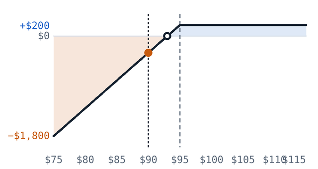

- **Farm:** You are paid a fee to promise to buy a neighbor's harvest at a set price, with the cash ready.
- **Goal:** Selling a put pays you now. If the price ends below the strike, you buy 100 shares at the strike.
- **Visual:** Profit at expiry for one short $95 put, with the $9,500 of cash it reserves.
- **Try it:** Sell a put below the market on a stock you would want to own, in the 2022 replay.

### 2.7 Assignment at expiry (4 min)

- **Farm:** On harvest day the deal settles, and the crop changes hands only if the lock is worth using.
- **Goal:** In-the-money options settle automatically at expiry, so know in advance what you will own or sell.
- **Visual:** Two branches at expiry for a covered call: price above the strike, price below it, and what happens to your shares and cash on each.
- **Try it:** Hold a covered call through expiry and watch the shares get called away.

### 2.8 Income versus upside (4 min)

- **Farm:** Selling your harvest ahead at a set price pays steadily, but you miss out if prices soar.
- **Goal:** Selling options earns steady income in flat markets and gives up gains in strong rallies.
- **Visual:** Shares alone against shares with monthly covered calls, in a rally and in a flat market.
- **Try it:** Run the same covered-call plan in a 60-day cut of the March 2020 rebound and a 60-day cut of the 2022 bear market.

### Reality check: Real-world options rules (2 min)

Real US stock options are American style and can be assigned before expiry, most often just before a dividend; Version 1 settles only at expiry. Brokers also approve options trading by level and ask you to read the Options Disclosure Document first.

### Gate to L3

- **Scenario:** A held-out variant of the 2022 rate-hike bear market
- **Quiz:** 10 to 15 questions from the L2 bank, pass at 80%
- **Challenge:** Stay at least 50% invested on average (cash reserved for a put counts), sell at least 4 covered calls or cash-secured puts, and finish with a smaller max drawdown than the broad-market ETF.
- Failed quizzes can be retaken after a short review. Levels never re-lock.

## L3: Long calls and puts

*After the L2 quiz and replay challenge. 8 lessons + 3 reality checks, 38 min.*

Unlocks: Buy calls and puts.

### 3.1 Buying a call (4 min)

- **Farm:** A call is a small deposit that locks today's wheat price for later.
- **Goal:** A long call profits above strike plus premium, and the most you can lose is the premium.
- **Visual:** Profit at expiry for one $100 call bought for $4, with the breakeven at $104. Drag the price to read profit.
- **Try it:** Buy a call in the March 2020 rebound.

### 3.2 Buying a put (4 min)

- **Farm:** A put is crop insurance: it pays when the price falls.
- **Goal:** A long put profits below strike minus premium, and it can protect shares you already own.
- **Visual:** Profit at expiry for one $100 put bought for $4, with the breakeven at $96.
- **Try it:** Buy a put on shares you hold before the March 2020 drop.

### 3.3 Leverage (4 min)

- **Farm:** A small deposit controls a whole harvest, so a small price move swings the deposit a lot.
- **Goal:** The same dollars in options move many times faster than in shares, in both directions.
- **Visual:** $1,000 in shares against $1,000 in calls, held to expiry, after the stock moves −10%, 0% and +10%.
- **Try it:** Split $2,000 between shares and calls in the meme-stock replay and compare.

### 3.4 Time decay (4 min)

- **Farm:** A price lock loses value as harvest day gets closer, and fastest in the final weeks.
- **Goal:** An option loses value every day, and the loss speeds up in the last month.
- **Visual:** The price of a 90-day at-the-money call as the days run out. Drag the days left and read the daily loss.
- **Try it:** Hold the same call for 30 days in a flat replay and watch its value drop.

### 3.5 Implied volatility (4 min)

- **Farm:** Crop insurance costs more in a stormy year, when everyone expects big price swings.
- **Goal:** Options cost more when the market expects big moves, and get cheaper when that fear fades.
- **Visual:** The price of the same 30-day call at different volatility levels, from a calm market to the March 2020 peak.
- **Try it:** Price one call before and after the March 2020 volatility peak.

### 3.6 Delta (4 min)

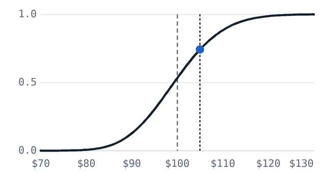

- **Farm:** Delta is how much your price lock gains when wheat rises $1 a bushel.
- **Goal:** Delta is how many dollars the option moves when the stock moves $1.
- **Visual:** Delta of a $100 call across stock prices, from near 0 to near 1. Drag the stock price and read delta.
- **Try it:** Read delta on 3 strikes, then predict how each moves on the next bar.

### 3.7 The greeks on one card (4 min)

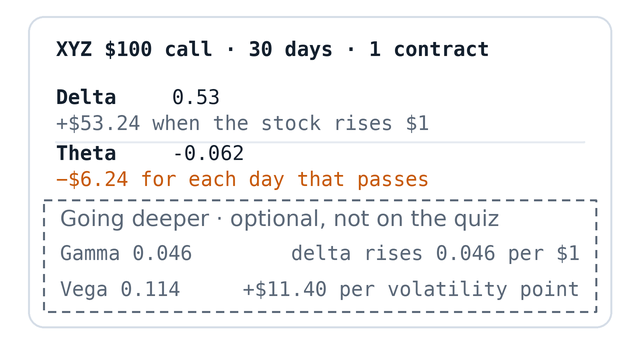

- **Farm:** The greeks tell you what moves your price lock: the wheat price, its speed, the days left and the weather.
- **Goal:** Read delta and theta together to see what will move your position most. Gamma and vega are optional extras.
- **Visual:** One position card with delta and theta up front, each written as dollars per contract. Gamma and vega sit in an optional Going deeper panel that is not on the L3 quiz.
- **Try it:** Open the greeks card on every position during one replay.

### 3.8 Why most short-dated options expire worthless (4 min)

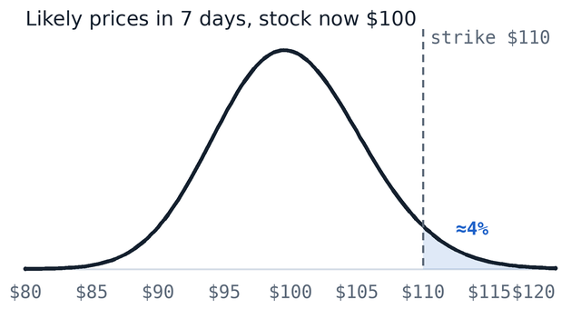

- **Farm:** Insurance against a once-in-a-lifetime frost is cheap because the frost almost never comes.
- **Goal:** A far out-of-the-money option with a week left needs a large move, and large moves are rare.
- **Visual:** The spread of likely prices one week out, with the small area above a $110 strike shaded and its probability shown.
- **Try it:** Buy a cheap one-week call and follow it to expiry.

### Reality check: How real option chains differ (2 min)

Replay option prices come from a model and carry a Modeled badge. Real chains are set by traders and have wider spreads on thinly traded strikes.

### Reality check: Earnings and the volatility drop (2 min) (new)

Option prices rise before an earnings report and fall right after it, so a call can lose money even when the stock rises. The live market raises volatility before a simulated earnings day and drops it after, so learners meet this in practice.

### Reality check: Options that expire today (2 min) (new)

Same-day-expiry options are the fastest way to lose a premium. Lesson 3.8's diagram explains why: with hours left, the move needed is large and the time for it is almost gone.

### Gate to L4

- **Scenario:** A held-out variant of the January 2021 meme-stock squeeze
- **Quiz:** 10 to 15 questions from the L3 bank, pass at 80%
- **Challenge:** Make at least 4 call or put trades with no more than 5% of the account in any one, and finish with less than a 10% drawdown.
- Failed quizzes can be retaken after a short review. Levels never re-lock.

## L4: Spreads

*After the L3 quiz and replay challenge. 6 lessons + 1 reality check, 28 min.*

Unlocks: Vertical debit and credit spreads. Iron condors and calendars come in a later release.

### 4.1 What a spread is (4 min)

- **Farm:** A spread buys one price lock and sells another to cut the cost.
- **Goal:** A spread buys one option and sells another on the same stock, which caps both the loss and the gain.
- **Visual:** A long $100 call and a short $110 call drawn thin, and their sum drawn thick: a line with a floor and a ceiling.
- **Try it:** Build your first spread in the order ticket and read its max loss before sending.

### 4.2 The bull call spread (5 min)

- **Farm:** Lock in the right to buy at $10 and sell someone the right to buy at $11: cheaper, but your gain stops at $11.
- **Goal:** Pay a debit to profit from a rise, with max loss, max gain and breakeven known before you trade.
- **Visual:** Profit at expiry for a $100/$110 call spread bought for $3.00.
- **Try it:** Open a bull call spread in the March 2020 rebound.

### 4.3 The bear put spread (4 min)

- **Farm:** Buy crop insurance at $10 and sell insurance at $9: cheaper cover for the drop in between.
- **Goal:** Pay a debit to profit from a fall, for less than a single put costs.
- **Visual:** Profit at expiry for a $100/$90 put spread bought for $2.80.
- **Try it:** Open a bear put spread in the 2008 financial crisis replay.

### 4.4 Credit spreads (5 min)

- **Farm:** Sell insurance and buy cheaper insurance behind it: you collect a fee, and your worst case is capped.
- **Goal:** Sell a spread to collect a credit now. The cash reserved equals your maximum loss.
- **Visual:** Profit at expiry for a $95/$90 put spread sold for $1.40, with $360 of cash reserved.
- **Try it:** Sell a put credit spread below the market in the 2022 replay.

### 4.5 Choosing strikes (4 min)

- **Farm:** A wider gap between the two locked prices costs more and can pay more.
- **Goal:** A wider spread can earn more but costs and risks more. Pick the width by how much you can lose.
- **Visual:** A call spread whose upper strike you drag from $105 to $120. Cost, max gain and max loss update as it widens.
- **Try it:** Price three widths on the same stock and pick one that fits your 2% risk limit.

### 4.6 Managing and closing early (4 min)

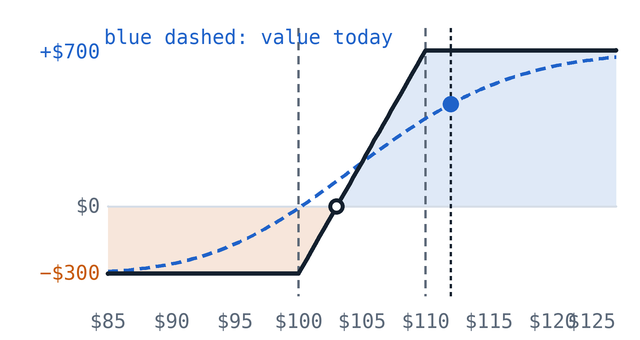

- **Farm:** You do not have to wait for harvest day: sell the deal early once it has paid enough.
- **Goal:** Close at a planned profit or loss instead of waiting for expiry.
- **Visual:** The spread's value today drawn as a curve over its value at expiry. Drag the days left and watch the curve settle onto the expiry line.
- **Try it:** Set a 50% profit target and close a spread early in the 2022 replay.

### Reality check: Defined risk is not no risk (2 min)

A spread tells you the worst case before you trade. It does not make the worst case unlikely, so size it like any other trade. Real brokers also require a higher options approval level before you can trade spreads.

### Final challenge (Level 4 badge)

- **Scenario:** A held-out variant of the 2008 financial crisis
- **Quiz:** 10 to 15 questions from the L4 bank, pass at 80%
- **Challenge:** Make at least 6 trades, all defined-risk, risk no more than 3% of the account on each, and finish with less than a 12% drawdown.
- Failed quizzes can be retaken after a short review. Levels never re-lock.

## Investing track

*Open after Level 1 and not required for any options gate. 6 lessons, 24 min. Accepted on Nov 28, 2026 (R7); four more lessons follow after launch.*

Unlocks: the Investing badge, and decades replays: monthly bars, 30 years in about 3 minutes, with a deposit each month.

### I.1 Goals and time horizon (4 min) (new)

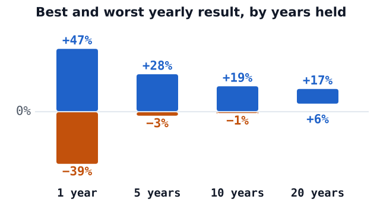

- **Farm:** Seed you need next spring should not go into an orchard that takes ten years to fruit.
- **Goal:** Money needed soon belongs in steadier things; money for decades can ride out the swings.
- **Visual:** The best and worst yearly result of a broad-market ETF held for 1, 5, 10 and 20 years: the range narrows as the years grow.
- **Try it:** Play one crash with money needed in a year, then with money needed in ten.

### I.2 Bonds and cash (4 min) (new)

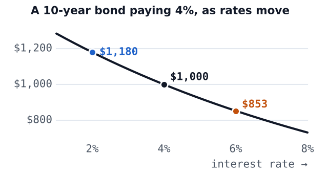

- **Farm:** Lending seed to a neighbor pays back a fixed amount; owning the farm pays whatever the harvest brings.
- **Goal:** A bond is a loan that pays interest, and its price falls when interest rates rise.
- **Visual:** A bond's price against a slider for the interest rate.
- **Try it:** Hold a bond fund through a cut of the 2022 replay.

### I.3 Asset allocation (4 min) (new)

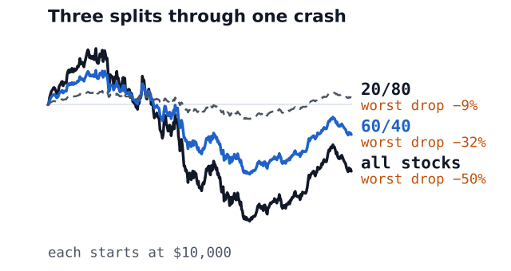

- **Farm:** Decide how much land goes to steady crops and how much to risky ones before the season starts.
- **Goal:** The split between stocks, bonds and cash sets most of how far an account swings.
- **Visual:** Three accounts through one crash: all stocks, 60/40 and 20/80, each labeled with its worst drop.
- **Try it:** Play the same replay with two different splits.

### I.4 Investing a little every month (4 min) (new)

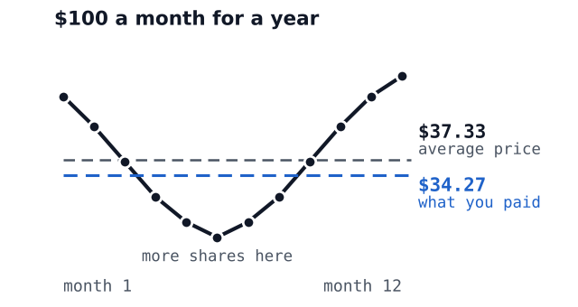

- **Farm:** Planting a row each week means no single week decides the harvest.
- **Goal:** A fixed amount each month buys more shares when prices are low and removes the timing decision.
- **Visual:** Monthly buys on a line that falls and then rises, with the average cost marked.
- **Try it:** A decades replay with a monthly deposit.

### I.5 Rebalancing (4 min) (new)

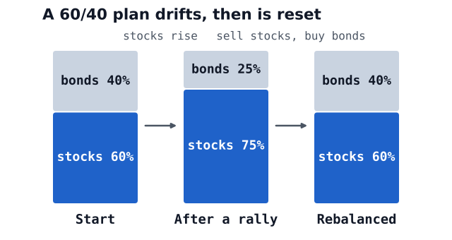

- **Farm:** When the orchard outgrows the wheat field, replant to get back to your plan.
- **Goal:** Selling some of what grew and buying what lagged holds risk at the level you chose.
- **Visual:** A 60/40 account drifting to 75/25, then reset.
- **Try it:** Rebalance once a year in a decades replay and compare with never rebalancing.

### I.6 Time in the market (4 min) (new)

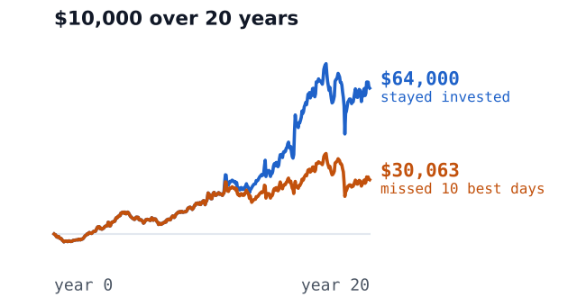

- **Farm:** A farmer who skips the ten best growing weeks of a decade loses much of the decade's harvest.
- **Goal:** Much of the long-run gain comes from a few strong days, and they tend to follow the worst ones, so selling in a crash often misses them.
- **Visual:** Twenty years fully invested against the same years without the ten best days.
- **Try it:** A decades replay played twice: stay invested, then sell after each 10% drop.

## Glossary

| Term | Meaning | Think of it like | Lesson |
|---|---|---|---|
| Share | One unit of ownership in a company. | A slice of the farm and its future harvests. | 1.1 |
| Dividend | Cash a company pays shareholders out of its profits. | The part of each harvest a farm pays out in cash. | 1.3 |
| Earnings | A company's profit over a period, the main driver of its price over time. | The farm's harvest after costs. | 1.3 |
| Bid and ask | The highest price a buyer offers and the lowest price a seller accepts. | What the grain dealer pays you, and what they charge you. | 1.5 |
| Bid-ask spread | The gap between bid and ask, paid on every round trip. | The grain dealer's cut. | 1.5 |
| Liquidity | How quickly you can sell without moving the price. | How easily you can find a buyer for your wheat on market day. | 1.5 |
| Market order | Buy or sell now at the best available price. | Sell the wheat at today's market price, whatever it is. | 1.6 |
| Limit order | Buy or sell only at your price or better. | Sell the wheat only at $8 a bushel or more. | 1.6 |
| Stop order | Sell once the price falls to a level you set. | Sell the wheat if the price drops to $6. | 1.6 |
| Diversification | Owning several unrelated holdings to smooth the path. | Growing wheat, corn and apples instead of one crop. | 1.8 |
| Risk and return | Investments that swing more are expected to pay more over time. | A grain store pays a little every year; a new orchard might pay a lot or nothing. | 1.9 |
| ETF | One fund, traded under one ticker, that holds many companies. | A co-op that owns hundreds of farms. | 1.10 |
| Expense ratio | The yearly fee a fund charges, as a percent of your money. | The share of every harvest the co-op keeps. | 1.11 |
| Index | A list of companies whose combined price shows how a market did. | What the whole valley grew this year. | 1.12 |
| Benchmark | The index you compare your results against. | The valley's harvest you hope to beat. | 1.12 |
| Position size | How much you put into one trade, set by how much you can lose. | How many acres you plant with one crop. | 1.13 |
| Risk tolerance | How much loss you can live with, in money and in nerves. | How bad a season you could get through without selling the farm. | 1.13 |
| Drawdown | The drop from the account's high point to its low point. | How far the farm's value falls from its best year. | 1.14 |
| Loss aversion | Feeling a loss more strongly than an equal gain, which leads to poor timing. | Refusing to sell a failing crop because selling would admit the loss. | 1.15 |
| Compounding | Gains that stay invested and earn their own gains. | Replanting seed from each harvest. | 1.16 |
| Inflation | Prices rising over time, which shrinks what money buys. | Bread costing a little more every year. | 1.16 |
| Option | A contract on 100 shares that gives the buyer a right and the seller an obligation. | A deal on 100 bushels. | 2.1 |
| Strike | The price written into the option. | The locked price per bushel. | 2.2 |
| Expiry | The last day the option exists. | Harvest day, when the deal settles. | 2.2 |
| In the money | An option that would be worth something if it settled now. | A price lock that beats the market price. | 2.2 |
| Premium | The price of an option, paid by the buyer to the seller. | The fee for holding a price. | 2.3 |
| Covered call | Selling a call on 100 shares you own. | Selling a buyer the right to your harvest at a set price. | 2.5 |
| Cash-secured put | Selling a put with the cash set aside to buy the shares. | Being paid to promise to buy a neighbor's harvest at a set price. | 2.6 |
| Assignment | The seller fulfilling the contract when an in-the-money option settles. | The crop changing hands on harvest day. | 2.7 |
| Call | The right to buy at the strike price until expiry. | A deposit that locks today's wheat price. | 3.1 |
| Breakeven | The price at which a trade neither makes nor loses money. | The wheat price at which the deal just pays for its fee. | 3.1 |
| Put | The right to sell at the strike price until expiry. | Crop insurance against a price drop. | 3.2 |
| Leverage | Controlling more value than the money you put in. | A small deposit that controls a whole harvest. | 3.3 |
| Time decay (theta) | The value an option loses each day. | A price lock that weakens as harvest day nears. | 3.4 |
| Implied volatility | How big a move the market expects, built into option prices. | How stormy the year looks. | 3.5 |
| Delta | How many dollars an option moves for a $1 move in the stock. | How much your price lock gains when wheat rises $1. | 3.6 |
| Gamma | How fast delta changes as the stock moves. | How quickly your price lock gets more sensitive. | 3.7 |
| Vega | How much an option's price changes when implied volatility moves 1 point. | How much insurance prices jump when storms are forecast. | 3.7 |
| Spread | Buying one option and selling another on the same stock. | Buying one price lock and selling another to cut the cost. | 4.1 |
| Debit spread | A spread you pay for up front. | Paying a smaller fee for a price lock with a ceiling. | 4.2 |
| Max loss and max gain | The worst and best results a trade can have, known before you trade. | The floor and the ceiling on the deal. | 4.2 |
| Credit spread | A spread you are paid for up front, with the max loss held as cash. | Selling insurance with cheaper insurance bought behind it. | 4.4 |
| Time horizon | How long until you need the money. | How many seasons until you need the seed back. | I.1 |
| Bond | A loan to a government or company that pays interest and returns the amount lent. | Lending seed to a neighbor for a fixed amount back. | I.2 |
| Asset allocation | How an account is split between stocks, bonds and cash. | How much land goes to steady crops and how much to risky ones. | I.3 |
| Regular investing | Putting in a fixed amount on a schedule, whatever the price. Also called dollar-cost averaging. | Planting a row every week, rain or shine. | I.4 |
| Rebalancing | Trading back to your chosen split after prices have moved it. | Replanting to get back to your plan. | I.5 |
| Margin | Money borrowed from a broker to buy more than your cash allows. Not offered in the app. | Planting on borrowed seed. | L1 check |
| Short selling | Selling borrowed shares, hoping to buy them back for less. Not offered in the app. | Selling a neighbor's wheat today and promising to return it later. | L1 check |

## Benchmark check (Nov 27, 2026)

Each lesson was checked against the Jump$tart national investing standards (grades 8 and 12), the SIFMA Stock Market Game curriculum and SEC investor.gov for Level 1, and the Options Industry Council and FINRA SIE outline for Levels 2 to 4. The changes this check suggested were approved on Nov 27 and are now in the lessons above, marked new.

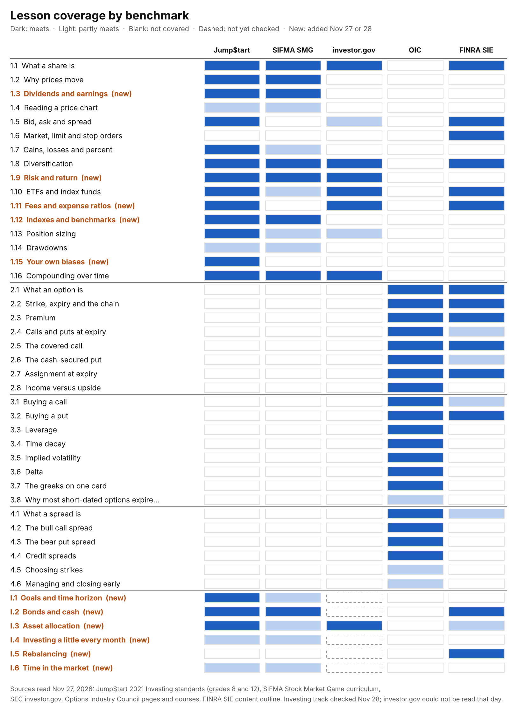

### What changed after the check

Approved by Prafull on Nov 27, 2026 and applied: five new Level 1 lessons (1.3, 1.9, 1.11, 1.12, 1.15), changes to 1.5, 1.13, 1.16 and 3.7, a new Level 1 reality check, and wider Level 2 and Level 4 reality checks. Level 1 lessons were renumbered.

### Coverage by lesson

| # | Lesson | Benchmarks met |
|---|---|---|
| 1.1 | What a share is | Jump$tart 8-4 · SIFMA SMG What is a Stock?; What is a Company? · investor.gov Investment products: stocks · FINRA SIE 2.1.1 Equity securities |
| 1.2 | Why prices move | Jump$tart 12-5 · SIFMA SMG What Causes Stock Prices to Change? |
| 1.3 | Dividends and earnings | Jump$tart 8-1, 8-4a, 12-2 · SIFMA SMG Dividends and Earnings; S7 |
| 1.4 | Reading a price chart | Jump$tart 8-2b find current prices (partly) · SIFMA SMG Interpreting Stock Quotes; S4 quote fields (partly) |
| 1.5 | Bid, ask and spread | Jump$tart 12-7; 8-2c · investor.gov Liquidity (partly) · FINRA SIE 3.1.1 Bid-ask; 2.2 Liquidity risk |
| 1.6 | Market, limit and stop orders | FINRA SIE 3.1.1 Market, stop, limit orders |
| 1.7 | Gains, losses and percent | Jump$tart 12-2 rate of return · SIFMA SMG S10 gains and losses (partly) |
| 1.8 | Diversification | Jump$tart 8-5a; 12-6 · SIFMA SMG What is Diversification?; S6 · investor.gov Asset allocation and diversification · FINRA SIE 2.2 Mitigation: diversification |
| 1.9 | Risk and return | Jump$tart 8-6, 12-3 · SIFMA SMG What is Risk? · investor.gov Risk and return |
| 1.10 | ETFs and index funds | Jump$tart 8-5; 12-13c · SIFMA SMG What is a Mutual Fund? (partly) · investor.gov Mutual funds, ETFs, index funds · FINRA SIE 2.1.9 ETPs; active vs passive |
| 1.11 | Fees and expense ratios | Jump$tart 12-7, 12-13c · investor.gov Fees · FINRA SIE 2.1.9 Fee considerations |
| 1.12 | Indexes and benchmarks | Jump$tart 12-13 · SIFMA SMG What is an Index?; S10 |
| 1.13 | Position sizing | Jump$tart 12-1a to 12-1c · SIFMA SMG S3 and S5 risk tolerance (partly) · investor.gov Managing risk (partly) |
| 1.14 | Drawdowns | Jump$tart 8-6 degrees of risk (partly) · SIFMA SMG What is Risk? (partly) |
| 1.15 | Your own biases | Jump$tart 12-9, 12-10 |
| 1.16 | Compounding over time | Jump$tart 8-7a to 8-7d; 12-4 · SIFMA SMG How Does Money Grow Over Time? · investor.gov Compound growth |
| 2.1 | What an option is | OIC What is an Option?; Options 101 · FINRA SIE 2.1.3 Puts and calls; hedging or speculation |
| 2.2 | Strike, expiry and the chain | OIC What is an Option? · FINRA SIE 2.1.3 Strike, expiration, in or out of the money |
| 2.3 | Premium | OIC What is an Option?: premium · FINRA SIE 2.1.3 Premium |
| 2.4 | Calls and puts at expiry | OIC Intrinsic vs time value · FINRA SIE 2.1.3 In the money (partly) |
| 2.5 | The covered call | OIC Covered Call; Produce Income · FINRA SIE 2.1.3 Covered vs uncovered |
| 2.6 | The cash-secured put | OIC Cash-Secured Put · FINRA SIE 2.1.3 Covered vs uncovered (partly) |
| 2.7 | Assignment at expiry | OIC Options 101: exercise and assignment · FINRA SIE 2.1.3 Exercise and assignment |
| 2.8 | Income versus upside | OIC Option Strategies: Selling Options |
| 3.1 | Buying a call | OIC Long Call · FINRA SIE 2.1.3 Varying strategies: long (partly) |
| 3.2 | Buying a put | OIC Long Put; Protective Put · FINRA SIE 2.1.3 Hedging; 2.2 Hedging |
| 3.3 | Leverage | OIC Leverage and Risk |
| 3.4 | Time decay | OIC Time Erosion vs Delta Effect; Theta |
| 3.5 | Implied volatility | OIC Options Volatility course |
| 3.6 | Delta | OIC Getting to Know the Greeks; Delta |
| 3.7 | The greeks on one card | OIC Greeks: gamma, theta, vega, rho |
| 3.8 | Why most short-dated options expire worthless | OIC Options Pricing (partly) |
| 4.1 | What a spread is | OIC All Strategies: spreads · FINRA SIE 2.1.3 Varying strategies (partly) |
| 4.2 | The bull call spread | OIC Bull Call Spread |
| 4.3 | The bear put spread | OIC Bear Put Spread |
| 4.4 | Credit spreads | OIC Bull Put Spread; Bear Call Spread |
| 4.5 | Choosing strikes | OIC Strategy pages (not confirmed) (partly) |
| 4.6 | Managing and closing early | OIC Not confirmed in pages read (partly) |
| I.1 | Goals and time horizon | Jump$tart 12-6; 12-6a · SIFMA SMG Life Goals video; holding periods (partly) · investor.gov (not checked) |
| I.2 | Bonds and cash | Jump$tart 8-3; 12-5d · SIFMA SMG What Is a Bond? · investor.gov (not checked) · FINRA SIE 2.1.2 Debt instruments: price and interest rate |
| I.3 | Asset allocation | Jump$tart 12-6; 12-6a; 12-6c · SIFMA SMG What is Diversification? (partly) · investor.gov Asset allocation and diversification · FINRA SIE 2.2 Mitigation: diversification (partly) |
| I.4 | Investing a little every month | Jump$tart 8-7c; 12-10b (partly) · SIFMA SMG How Does Money Grow Over Time? (partly) · investor.gov (not checked) |
| I.5 | Rebalancing | investor.gov (not checked) · FINRA SIE 2.2 Mitigation: portfolio rebalancing |
| I.6 | Time in the market | Jump$tart 8-7d; 12-9 (partly) · SIFMA SMG Buy, Sell, or Hold?; holding periods (partly) · investor.gov (not checked) |

The investing-track rows were added on Nov 28, 2026, from the Jump$tart standards, the Stock Market Game 32-week map and the FINRA SIE outline, all read that day. investor.gov refused automated access that day, so its cells are marked "not checked" rather than guessed, except I.3, which uses the page the Nov 27 check had read. No benchmark teaches cost averaging or missing the best days by name, so I.4 and I.6 meet theirs only partly, and only the SIE outline names rebalancing. The five new reality checks are not in the map; the taxes one matches Jump$tart 12-8a.

### Gaps the check found, and how each was closed

- **Risk and return:** Riskier assets are expected to pay more, and their results swing more. (Jump$tart 8-6, 12-3; SMG What is Risk?; investor.gov.) Now: Added as 1.9.
- **Fees and expense ratios:** Yearly fund fees compound against you; index funds cost less than active funds. (Jump$tart 12-7, 12-13c; investor.gov Fees; SIE 2.1.9.) Now: Added as 1.11.
- **Benchmarks and indexes:** Results are judged against an index such as the S&P 500, not against zero. (Jump$tart 12-13; SMG What is an Index?, S10.) Now: Added as 1.12.
- **Dividends and earnings:** Returns come from price change plus cash paid out; prices follow earnings. (Jump$tart 8-1, 8-4a, 12-2; SMG Dividends and Earnings, S7.) Now: Added as 1.3.
- **Behavioral biases:** Loss aversion and chasing winners lead to buying high and selling low. (Jump$tart 12-9, 12-10.) Now: Added as 1.15.
- **Investment fraud:** Guaranteed returns, pressure and pump-and-dump hype are red flags. (Jump$tart 12-12; investor.gov Fraud; SMG Investor Safety.) Now: Added as a Level 1 reality check.
- **Inflation and real return:** A 7% return with 3% inflation grows buying power by about 4%. (Jump$tart 12-4.) Now: Added to 1.16.
- **Liquidity:** Thinly traded stocks have wider spreads and are harder to sell fast. (Jump$tart 8-2c; investor.gov Liquidity; SIE 2.2.) Now: Added to 1.5.
- **Real-world options rules:** Brokers approve options by level, require the Options Disclosure Document, and US stock options are American style. (SIE 2.1.3, 3.2.1; OIC Getting Started.) Now: Level 2 reality check widened.

### Lessons beyond the benchmarks for their level

- **1.4 Candlestick charts:** No benchmark teaches candles; Jump$tart and SMG stop at reading quotes. Now: Kept, marked as an app skill rather than a standard.
- **1.13 and 1.14 Position sizing and drawdown:** Trader practice; the benchmarks teach risk tolerance instead. Now: Kept (the gates use drawdown); 1.13 now opens with a risk-tolerance check.
- **3.5 to 3.8 Volatility and the greeks:** Beyond the SIE, an entry-level exam; only OIC's Advanced Concepts covers them. Now: 3.7 now leads with delta and theta; gamma and vega are optional and off the L3 quiz.
- **L4 Spreads, credit spreads above all:** SIE names only long and short strategies; OIC covers spreads, and brokers put them at higher approval levels. Now: Kept; the L4 reality check now says real brokers gate spreads.

### Left out on purpose

- Bonds and asset allocation beyond one comparison line (Jump$tart 8-3, 12-6; SMG S8): the simulator trades stocks, ETFs and options only. Update Nov 28: now covered by investing-track lessons I.2 and I.3, using a bond ETF.
- Taxes, retirement accounts and choosing an adviser or robo-adviser (Jump$tart 12-8, 12-11, 12-14): real-account topics, outside a simulator. Update Nov 28: taxes on gains now have a Level 1 reality check; the rest stays out.
- Short selling, margin and naked options (SIE 3.1.1, 3.2.1): high risk and not offered in the app. Update Nov 28: margin and short selling are explained in a Level 1 reality check and still not offered.
- Index options, straddles, condors and calendars (SIE 2.1.3; OIC): left for a later release, as the spec already says.

### Sources

- [Jump$tart](https://www.jumpstart.org/wp-content/uploads/2023/04/2021_Natl_Standards_Downloadable_final.pdf): 2021 National Standards for Personal Financial Education, Investing grades 8 and 12
- [SIFMA SMG](https://www.stockmarketgame.org/document/Fall2020_32wk_curriculum_map.pdf): SIFMA Foundation Stock Market Game curriculum maps and Essential Syllabus
- [investor.gov](https://www.investor.gov/introduction-investing): SEC Introduction to Investing and Investment Products
- [OIC](https://www.optionseducation.org/strategies/all-strategies-en): Options Industry Council: OCC Learning courses, Options Overview, Strategies, Advanced Concepts
- [FINRA SIE](https://www.finra.org/sites/default/files/SIE_Content_Outline.pdf): FINRA Securities Industry Essentials exam content outline

## Review refinements (Nov 28, 2026)

A review of all four documents on Nov 28, 2026 produced refinements R1 to R31, listed in the [spec](spec.md#review-refinements-nov-28-2026). Prafull decided all of them the same day. This section records what changed in this plan and what was accepted for after launch.

### Applied to this plan

- **Every "Try it" is a concept replay** of 20 to 60 bars, never the live market and never a gate's path (R1, R3, R4). Nine lessons changed:

| Lesson | "Try it" before | Problem | "Try it" now |
|---|---|---|---|
| 1.1 | Buy 10 shares in the live market | The live market was closed in the evening and at weekends | A 20-day concept replay |
| 1.2 | One full trading day of the January 2021 squeeze at 1 minute per second | 390 bars took 6.5 minutes, on the L3 gate's path | 60 one-minute bars of a busy morning |
| 1.3 | Hold a dividend payer through one replay year | About 42 minutes at the fastest speed | One year at one day per second, skipping to each dividend date |
| 1.8 | Play the 2000 dot-com replay twice | The full window took hours | A 60-day cut, played twice |
| 1.10 | Buy an ETF in the live market and open its holdings | Live market | The same steps in a concept replay |
| 1.15 | Review your trades from the January 2021 replay | Sent a Level 1 learner through the L3 gate's path | Review the trades from the learner's most recent replay |
| 2.1 | Open the option chain in the live market | Live market | The chain in a concept replay |
| 2.5 | Sell one covered call a month in the 2022 replay | About 42 minutes for the year | Three monthly expiries with "Skip to next event" |
| 2.8 | Run one plan in the March 2020 rebound and the 2022 bear market | Two long replays | Two 60-day cuts |

- **Gates run on held-out variants and need real exposure** (R1, R2). The old rules could be passed from memory, or with 97% of the account in cash. The new rules are in each level's gate above.
- **Replays from Level 2 up start with $100,000** (R5), so a covered call or a cash-secured put no longer takes the whole account.
- **Every replay gets a debrief** from rule-based findings, each tied to its lesson: position too large (1.13), no stop (1.6), buying high and selling low (1.15), one stock too large a share (1.8), an option held through its fastest decay (3.4). AI words it once a day (R6).
- **The live market is always open** (R4), and the Level 1 reality check on simulated prices now also teaches real exchange hours.
- **Lessons are ready for other markets** (R22): stable ids, no color words in lesson text, and amounts and crops as values the market pack fills in. Nothing a US learner sees has changed.
- **A six-lesson investing track** opens after Level 1 (R7): goals and time horizon, bonds, asset allocation, monthly investing, rebalancing and time in the market. None needs company fundamentals. Before this, 22 of the 38 lessons were about options.
- **Five more reality checks** (R10): taxes, settlement and day-trading rules, and margin and short selling in Level 1; the earnings volatility drop and same-day-expiry options in Level 3.
- **The learning loop** near the top of this plan (R8, R9, R26, R29): a placement check, spaced review, a plan before the trade, a scorecard for the learner's own calls and limits the learner sets.
- **Lesson text may be drafted by AI and is approved by Prafull** (R11). No outside reviewer signs off; the benchmark check above and the sources it cites are the accuracy reference.

### Lesson ids

Each lesson has a stable id that is not its number, so adding or reordering lessons never breaks a link, a "study next" pointer or a saved result. The number is only for display. (The Level 1 renumbering on Nov 27 had left one wrong lesson number in the design guide.)

| # | Lesson | Id |
|---|---|---|
| 1.1 | What a share is | `what-a-share-is` |
| 1.2 | Why prices move | `why-prices-move` |
| 1.3 | Dividends and earnings | `dividends-and-earnings` |
| 1.4 | Reading a price chart | `reading-a-price-chart` |
| 1.5 | Bid, ask and spread | `bid-ask-and-spread` |
| 1.6 | Market, limit and stop orders | `order-types` |
| 1.7 | Gains, losses and percent | `gains-losses-and-percent` |
| 1.8 | Diversification | `diversification` |
| 1.9 | Risk and return | `risk-and-return` |
| 1.10 | ETFs and index funds | `etfs-and-index-funds` |
| 1.11 | Fees and expense ratios | `fees-and-expense-ratios` |
| 1.12 | Indexes and benchmarks | `indexes-and-benchmarks` |
| 1.13 | Position sizing | `position-sizing` |
| 1.14 | Drawdowns | `drawdowns` |
| 1.15 | Your own biases | `your-own-biases` |
| 1.16 | Compounding over time | `compounding-over-time` |
| 2.1 | What an option is | `what-an-option-is` |
| 2.2 | Strike, expiry and the chain | `strike-expiry-and-the-chain` |
| 2.3 | Premium | `premium` |
| 2.4 | Calls and puts at expiry | `calls-and-puts-at-expiry` |
| 2.5 | The covered call | `the-covered-call` |
| 2.6 | The cash-secured put | `the-cash-secured-put` |
| 2.7 | Assignment at expiry | `assignment-at-expiry` |
| 2.8 | Income versus upside | `income-versus-upside` |
| 3.1 | Buying a call | `buying-a-call` |
| 3.2 | Buying a put | `buying-a-put` |
| 3.3 | Leverage | `leverage` |
| 3.4 | Time decay | `time-decay` |
| 3.5 | Implied volatility | `implied-volatility` |
| 3.6 | Delta | `delta` |
| 3.7 | The greeks on one card | `the-greeks-on-one-card` |
| 3.8 | Why most short-dated options expire worthless | `short-dated-options` |
| 4.1 | What a spread is | `what-a-spread-is` |
| 4.2 | The bull call spread | `the-bull-call-spread` |
| 4.3 | The bear put spread | `the-bear-put-spread` |
| 4.4 | Credit spreads | `credit-spreads` |
| 4.5 | Choosing strikes | `choosing-strikes` |
| 4.6 | Managing and closing early | `managing-and-closing-early` |
| L1 check | Why simulated prices differ | `check-simulated-prices` |
| L1 check | Spotting investment scams | `check-investment-scams` |
| L2 check | Real-world options rules | `check-real-options-rules` |
| L3 check | How real option chains differ | `check-real-option-chains` |
| L4 check | Defined risk is not no risk | `check-defined-risk` |
| I.1 | Goals and time horizon | `goals-and-time-horizon` |
| I.2 | Bonds and cash | `bonds-and-cash` |
| I.3 | Asset allocation | `asset-allocation` |
| I.4 | Investing a little every month | `regular-investing` |
| I.5 | Rebalancing | `rebalancing` |
| I.6 | Time in the market | `time-in-the-market` |
| L1 check | Taxes on gains | `check-taxes-on-gains` |
| L1 check | Settlement and day-trading rules | `check-settlement-and-day-trading` |
| L1 check | Margin and short selling | `check-margin-and-short-selling` |
| L3 check | Earnings and the volatility drop | `check-earnings-volatility-drop` |
| L3 check | Options that expire today | `check-same-day-expiry` |

### Core lessons and market modules

| Part | Travels to other markets |
|---|---|
| Level 1 (1.1 to 1.16) and its reality checks | Core. 1.5 and 1.6 take tick sizes and order types from the market pack, 1.11 uses local fund fees, and 1.12 names the local index. |
| Levels 2 to 4 | US pack. The ideas travel, but the lessons are built on 100-share contracts, American-style exercise and US broker approval levels. Markets where beginners meet index options first (India, Japan, Korea) need their own Level 2, and markets with few listed options (Singapore, Mexico) may replace the ladder with REITs and ETFs. |
| Investing track (I.1 to I.6) | Core. Tax and account lessons are written per market, and I.10, after launch, changes its home market. |

### Accepted for after launch

#### Four more investing lessons (R7)

These need modeled company fundamentals or several countries' modeled indexes, which arrive after launch (R30).

| # | Lesson | Farm line | Goal | Diagram | Try it |
|---|---|---|---|---|---|
| I.7 | Size and sector | A valley has big old farms and small new ones, and grain, fruit and dairy have their good years at different times. | A company's size and sector explain much of how its stock moves. | A market drawn as blocks grouped by sector and sized by company value. | Compare a large company and a small one from the same sector in one replay. |
| I.8 | What a share costs: price to earnings | Paying 30 harvests for a farm only makes sense if the harvests will grow. | Price divided by earnings per share is how many years of today's profit you pay for; a high number needs growth to justify it. | One price with a slider for earnings, and the growth needed to bring the ratio down to the market's. | Sort a replay's stocks by this ratio before the dot-com cut and see what followed. |
| I.9 | Reading a company's numbers | Before buying a farm, ask what it sold, what it kept and what it owes. | Find revenue, profit and debt in a company summary, and know that real filings are free to read. | Revenue stepping down through costs to profit, beside a bar for debt. | Compare two companies' summary cards inside a replay. |
| I.10 | Home bias and currency | A farmer who knows only one valley forgets that other valleys have different weather. | Markets in different countries do not move together, and one market can stay below its peak for decades, as Japan's did after 1989. Foreign holdings also move with the exchange rate. | Three countries' modeled index lines over 35 years, with the longest time below a peak shaded. | Split an account between two markets in a decades replay. |

#### Investing-style lenses (R28)

Lessons I.8 and I.9 each end with a lens: a short checklist, computed by rule from a company's modeled numbers, of what one investing style looks at. Value asks whether the price is low against earnings and book value and whether debt is modest. Quality asks whether profits are steady and returns on capital high. Growth at a fair price sets the price-to-earnings ratio against the growth rate. Trend asks whether price and earnings are both rising. A lens states facts against a style's usual thresholds ("31 times earnings; a value approach looks for under 15 to 20") and never says buy or sell. It does not appear in live mode. Lesson text credits the investors whose books describe each style; no AI speaks in their names.

#### A strategy lab after Level 4 (R27)

A capstone for learners who hold the Level 4 badge. The learner builds a rule-based strategy from blocks (a style lens, a rebalance schedule, risk limits), runs it on practice variants against the broad-market ETF, then on a variant it has never seen.

| # | Lesson | Goal |
|---|---|---|
| S.1 | Rules beat hunches | A strategy is a rule you could hand to someone else: what to buy, how much, and when to sell. |
| S.2 | Testing on the past, honestly | A backtest may use only what was known on each day. Using tomorrow's numbers makes any rule look good. |
| S.3 | Overfitting | A rule tuned until it wins on one path usually loses on the next. The held-out variant shows the gap. |
| S.4 | Costs and turnover | Every trade pays the spread, so a rule that trades often must earn more just to stay level. |
| S.5 | Did it beat the index? | Most strategies end behind a broad-market ETF after costs. Knowing that is the most useful result in the lab. |

#### One decision a day (R9)

A two-minute question on a short, unlabeled chart ("Your stop is $96 and the stock opens at $91. Where does it fill?"), cut from scenario variants. No streak is attached to it.

## Notes

- All four gates use the rules accepted on Nov 28, 2026 (R1 and R2). Their thresholds are starting points, held in Remote Config and tuned in playtests.
- Diagram numbers are worked examples: option prices use Black-Scholes, 30% volatility, 4% rate unless noted. The investing-track diagrams use illustrative figures and seeded synthetic paths, not market data.
- The scripts that draw the investing-track diagrams and the coverage map are in `docs/images/src/`; the coverage map is drawn from the Coverage by lesson table above.
- Lesson text, quiz items and news beats may be drafted by AI. Prafull approves every one before it ships (R11, decided Nov 28). At run time AI is used only for debriefs.
- The Review refinements section (Nov 28, 2026) records what was applied and what was accepted for after launch. Nothing in this plan is awaiting sign-off.
